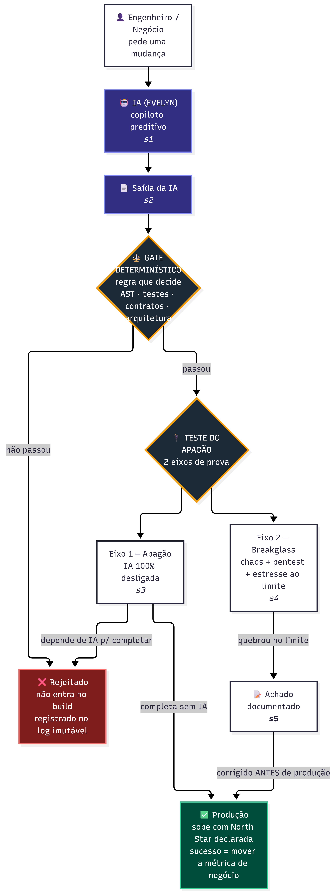
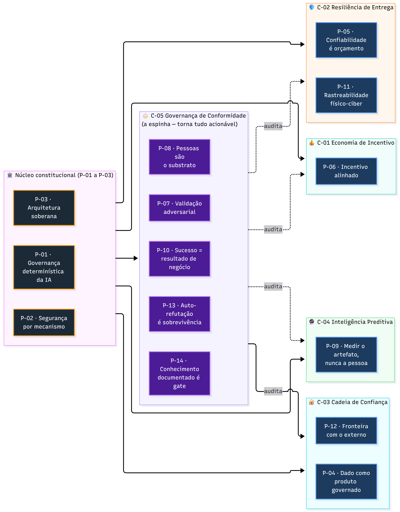
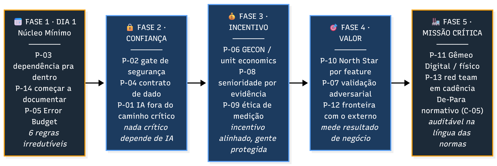
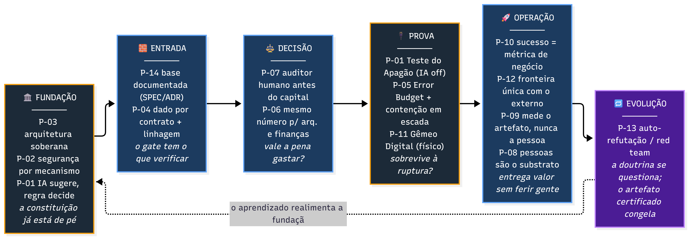

# 🧭 Z2A — Framework de Governança de Engenharia

### *para contextos de missão crítica*


---

> **O que é este documento.** É a fonte única do Z2A. Tudo que o framework é — a visão, a gramática, as 14 leis, as 5 capacidades, o kernel inviolável e a cultura — está explicado aqui, uma vez, sem mandar você abrir outro arquivo. Não trata de tese acadêmica, de produto comercial nem de implementação específica: trata do **framework**, e só dele. Se você vai conhecer o Z2A por um único texto, é este.

---

## PARTE I — A VISÃO

### 1.1 O que é o Z2A (Zenith To Aether)

O Z2A é uma **fusão de melhores práticas de engenharia com a IA como copiloto e motor de evolução**. Ele não inventa a roda: pega o que já é sólido — Clean Architecture, Domain-Driven Design, Zero-Trust, SRE, FinOps — e costura num organismo coerente. A IA, nesse organismo, não é mágica nem substituto: é um interpretador e copiloto de elite que **acelera** o trabalho, mas nunca completa sozinho um caminho crítico.

O Z2A é, antes de tudo, uma **máquina de transformação**: pega um negócio em qualquer estágio e o leva a um patamar superior de governança, confiabilidade e evolução. Ele é portável por desenho — não amarra quem adota a ferramentas, prazos ou arquiteturas específicas. As leis valem para uma fintech, uma transportadora, um hospital ou uma fábrica; o que muda é só a calibração.

Cada domínio da operação é tratado como um **plugin acoplável por software** (a lógica *Software-Defined everything*): segurança, dados, confiabilidade, finanças, pessoas — cada um tem contrato claro e se acopla conforme a necessidade, em vez de ser um departamento rígido. Não é um monólito obrigatório; acopla-se só o que a dor justifica.

### 1.2 A inversão deliberada — negócio no centro, humano como substrato

O Z2A faz uma inversão consciente: sai do dogma "ser humano no centro" e põe o **negócio e a tecnologia no centro** — **sem** escantear o humano. A razão é honestidade, não frieza.

A maioria dos sistemas estampa "pessoas em primeiro lugar" e age ao contrário; a frase vira ornamento. O Z2A faz o oposto: assume em voz alta que o foco é o **resultado de negócio**, e protege o humano por **mecanismo**, não por slogan.

O humano não é o objetivo declarado (que vira retórica vazia). Ele é o **substrato vivo e inegociável** — as células que mantêm o organismo vivo. Tirar o humano não é "enxugar": é matar o sistema. Sem gente não existe empresa, só uma marca, um nome vazio. O vocabulário biológico (células, organismo) não é decoração — ele codifica que o humano é **condição de vida** do sistema, não peça substituível.

Essa inversão é a semente de um par de leis que só fazem sentido juntas: **negócio no centro** (o sucesso é resultado de negócio) + **humano como substrato** (a dívida humana se trata como dívida técnica). E a cláusula que impede o foco no negócio de virar exploração é também mecanismo, não discurso: **mede-se o artefato, nunca a pessoa**. Essas três leis, lidas juntas, são a espinha ética do Z2A.

### 1.3 A tese central, em uma frase

**A IA sugere; a regra determinística decide.** A IA é o turbo, não o combustível. Se ela some, o carro ainda anda. Todo o resto do framework é a engenharia que torna essa frase verdadeira e verificável — não um voto de confiança, mas uma propriedade que se testa.



> **Em que dimensão o Z2A atua — mais TOGAF que ISO.** Missão crítica tem três camadas: infraestrutura (o sistema fica de pé?), artefato (o produto está correto?) e **processo/governança** (o jeito de construir é confiável e auditável?). O Z2A atua na **terceira** — ele governa *como* o software é decidido, auditado e evoluído, com a IA subordinada a regras determinísticas. Não é framework de infraestrutura, nem norma de certificação de artefato: é um framework de **método e governança** (como o TOGAF), não uma norma que emite selo de conformidade (como a ISO ou a DO-178C). Em uma frase: *o Z2A não garante que o avião voa — garante que o processo que decidiu colocar aquele código no avião foi determinístico, auditável e resistente à ausência de IA.* O detalhe completo está na seção 1.4 do [`Z2A.md`](_FRAMEWORK_V6/Z2A.md).

---

## PARTE II — A GRAMÁTICA (como ler e auditar o Z2A)

Antes das leis, a língua. Sem esta gramática, o Z2A parece um catálogo de regras. Com ela, vira uma constituição auditável — a língua de quem precisa dizer *"isto fere a lei P-04 e é oposto à P-10, revisar"*.

### 2.1 Os três estatutos: Lei · Sugestão · Cultura

Toda afirmação dentro do Z2A cai em uma de três categorias, e saber em qual ela está evita 90% das discussões inúteis:

- **Lei** — o princípio normativo. Não se negocia sem emitir uma nova versão do framework. É a **frase normativa** de cada princípio. Discordar dela é discordar do framework.

- **Sugestão** — o "como" técnico: ferramentas, latências, janelas, limiares, nomes de biblioteca. Deliberadamente vago e trocável à vontade. Discordar disso é só calibrar — troque sem pedir licença.

- **Cultura** — o vocabulário de identidade: nomes de papéis, ritos, codinomes. **Preservado, nunca higienizado.** Não é "como" — é identidade social; responde "quem é / o que vive / a que grupo pertence".

A linha fina: **nome de papel, rito ou codinome fica** (é identidade); **rótulo de conceito abstrato ganha um nome técnico neutro para uso externo** (a tradução para quem está de fora). Os dois públicos coexistem — o codinome na conversa interna, o nome técnico para o mundo.

> **Teste de leitura rápido:** discordou de uma ferramenta, um número ou uma janela de tempo? Você discordou de **Sugestão** — troque à vontade. Discordou da frase normativa? Aí é a **Lei** — e mudá-la é emitir uma nova versão do framework.

### 2.2 A estrutura de autoridade (a analogia financeira)

Cada lei do Z2A se organiza em três níveis de autoridade, espelhando como a legislação financeira se organiza (lei ordinária + lei complementar + notas explicativas):

| Nível | O que é | Analogia | Estatuto |

|-------|---------|----------|----------|

| **Princípio** | a frase normativa curta e verificável — o que se audita | a **LEI** | Lei |

| **Critério observável** | como verificar "cumpre ou não cumpre" | a régua que torna a lei acionável | régua |

| **Nota explicativa** | o **porquê**: a patologia que a lei cura | as notas que fundamentam a lei | justificativa |

| **Invariantes complementares** | o detalhamento fino da lei | a **lei complementar** que detalha a ordinária | detalhamento |

**A regra de ouro do complementar:** ele **detalha, não compete**. Um invariante complementar nunca contradiz a lei-mãe — ele a especializa, mostra uma face dela. Assim como a lei complementar não revoga a ordinária.

Essa estrutura resolve um problema real: muitas áreas do framework se cruzam (segurança, dados e fronteira externa se tocam o tempo todo). Em vez de criar leis que colidem, o Z2A cria **leis-mãe** e trata as sobreposições como complementos explicados.

### 2.3 Como auditar conformidade (o objetivo central)

O ponto do Z2A é permitir **auditoria por conformidade**: olhar uma decisão, uma arquitetura ou uma proposta e dizer, de forma rastreável, *"isto fere a P-NN e é oposto à P-MM — revisar"*. Essa é a língua das normas de missão crítica: princípios numerados, auditados um a um.

Por isso cada lei tem um **critério observável** — sem ele, "conformidade" vira opinião. Exemplo de uso real: *"esse novo serviço grava dado de treino direto do registro forense — fere a lei do dado governado (planos não se contaminam) e enfraquece a auditoria imutável. Revisar antes de seguir."*

---

## PARTE III — O KERNEL INVIOLÁVEL

Antes das 14 leis, há um kernel que todas elas assumem como piso. São quatro peças que, juntas, formam o núcleo inviolável do Z2A.

### 3.1 A constituição arquitetural

- **Domínio soberano.** A regra de negócio é o centro; a dependência aponta sempre para dentro. Infraestrutura, nuvem, framework e IA são periferia substituível. Troca-se o fornecedor sem reescrever o negócio.

- **IA não-autoritativa.** A IA sugere; a regra determinística decide. Nenhum caminho crítico depende de IA para completar.

- **Blameless.** Erro honesto é bug de governança ("a culpa é do martelo"), não caça às bruxas. A malícia é a exceção punível. A cultura do medo esconde falhas; a cultura blameless as revela.

### 3.2 O Teste do Apagão (a prova-heroína)

A prova central e falseável do Z2A, e o que o distingue de "usar IA com cuidado". Tem dois eixos:

- **Eixo 1 — Apagão (disponibilidade sob ausência de IA).** Desligue 100% da IA, ou injete respostas corrompidas: **todos** os fluxos críticos (autenticação, faturamento, fiscal, deploy e os demais da topologia do negócio) devem completar. Toda saída de IA que entra no sistema passou por um portão determinístico (análise de código / testes / contratos) e carrega assinatura que permite reproduzir a decisão. *A IA é o turbo, não o combustível.*

- **Eixo 2 — Breakglass (resiliência sob estresse destrutivo).** Antes de produção, o sistema passa por uma bateria de **destruição controlada**: chaos engineering + injeção de ataques e pentest de várias naturezas + simulação de falhas + estresse de código até o limite. Tudo o que não sobrevive é **documentado e corrigido antes de produção**. A analogia é o teste de envelope do automóvel: a maçaneta projetada para 10 mil usos é levada ao uso 10.001 para descobrir onde quebra **antes do cliente**.

**Dois casos-âncora que explicam o espírito:**

- **Apollo 11** — o software **previu a própria sobrecarga** (os alarmes 1201/1202) e **degradou com prioridade** em vez de travar. O acerto: resiliência projetada no envelope.

- **Challenger** — a falha dos anéis de vedação sob frio **foi prevista e ignorada**. O erro: testar e apontar não basta; é preciso **agir sobre o achado**.

> **Ressalva de humildade (parte do critério).** Nenhum teste de limite prova correção total — prova **robustez até os cenários testados**. Por isso a documentação do achado **e a ação sobre ele** são, elas mesmas, parte do critério: apontar e ignorar (Challenger) é falha, não conformidade.

### 3.3 As três moedas (a economia que não se corrompe)

A economia interna do Z2A opera três carteiras tecnicamente **não-conversíveis** entre si — e a não-conversibilidade é o mecanismo, não uma regra de etiqueta:

- **Z-Points** — liquidez, reconhecimento de trabalho.

- **Error Budget** — confiabilidade. Quando zera, congela feature nova e libera só restauração.

- **CNF** — reputação não-fungível, que **não se compra com liquidez**.

A regra-mãe: *"dinheiro compra equity; reputação compra poder."* Como as moedas não se convertem, a liquidez nunca compra poder — essa é a trava que impede o incentivo financeiro de corromper a governança técnica.

### 3.4 Topologia de dados e versionamento

- **Triplo Plano de Dados.** Três planos que nunca se contaminam: **Truth** (a verdade forense, imutável), **Intelligence** (o único material de treino de IA) e **HUD** (a camada de apresentação/interface). O dado forense nunca vaza para o treino; a interface nunca escreve no registro forense.

- **Versionamento constitucional + máquina de estados.** O framework versiona a si mesmo (mudar uma Lei = nova versão) e opera por estados explícitos de degradação graciosa: operação normal → alerta → contenção → lockdown. A estabilidade é contratual, não acidental.

---

## PARTE IV — AS 14 LEIS

As 14 leis são a constituição auditável do Z2A. A ordem é autoridade: as três primeiras são a constituição que todas as outras assumem. Cada lei tem **cinco campos**, na estrutura de autoridade da Parte II: a **frase normativa** (a Lei), o **critério observável** (como auditar), a **nota explicativa** (o porquê — a patologia que cura), os **invariantes complementares** (a lei complementar que detalha a ordinária, numerados C-PNN.x) e a **origem** (de onde a lei nasceu). O complementar sempre **detalha, nunca compete** com a lei-mãe.



---

### P-01 · Governança determinística da IA

**Frase normativa (Lei).** A IA é um componente probabilístico que **sugere**; a decisão do que entra no build e do que completa o caminho crítico é de uma **regra determinística**. Nenhum caminho crítico de negócio pode depender de IA para completar.

**Critério observável.** Em dois eixos. **Eixo 1 — disponibilidade sob ausência de IA:** com 100% da IA desligada ou injetando respostas corrompidas, todos os fluxos críticos (auth, faturamento, fiscal, deploy) completam; toda saída de IA passou por portão determinístico (análise de código / testes / contratos) e carrega assinatura reproduzível. **Eixo 2 — resiliência sob estresse destrutivo:** antes de produção, o sistema passa pela bateria de destruição controlada (chaos + pentest + simulação de falhas + estresse ao limite); o que não sobrevive é documentado **e corrigido antes de produção**.

**Nota explicativa (o porquê).** Mata a dependência oculta de um componente probabilístico no caminho crítico (o blackout de IA derrubando faturamento e login), a automação da ignorância (IA como muleta), a câmara de eco (IA validando IA) e a armadilha do "completar ≠ completar corretamente" (que o Eixo 2 ataca). Os casos-âncora: Apollo 11 (previu a sobrecarga e degradou com prioridade — o acerto) e Challenger (previu a falha dos anéis e ignorou — o erro: apontar não basta, é preciso agir sobre o achado).

**Invariantes complementares.**

- **C-P01.1** — IA sem commit direto: toda saída é "sugestão de risco máximo" que só entra após o portão.

- **C-P01.2** — Toda ação de IA é auditável e reproduzível (assinatura: modelo / temperatura / seed).

- **C-P01.3** — Regimes de participação da IA: cada decisão cai num regime conforme risco — verificação determinística, admissão calibrada, guerra adversarial IA×IA, adjudicação humana assistida, ou caminho determinístico sem IA. O binário "sugere / decide" é refinado num espectro.

- **C-P01.4** — A inteligência preditiva é copiloto, não muleta: vive no plano de controle, nunca no plano de dados; se cai, o que foi previsto assume e o humano arbitra. O risco residual é a integridade da inteligência (gerenciável), não a disponibilidade (fatal).

- **C-P01.5** — Breakglass: bateria de destruição controlada com documentação obrigatória do ocorrido **e ação sobre o achado** antes de produção. Não prova correção total — prova robustez até os cenários testados.

**Origem.** Teste do Apagão + a constituição do núcleo (IA não-autoritativa) + a inteligência preditiva como copiloto, refinada pelos regimes de participação.

---

### P-02 · Segurança por mecanismo, não por confiança

**Frase normativa (Lei).** A segurança é decidida por regra determinística, não por julgamento probabilístico nem por vontade humana sob pressão: toda ação é auditável, toda identidade é verificada a cada chamada, e o registro de auditoria é imutável.

**Critério observável.** Mudança com vulnerabilidade detectável é bloqueada automaticamente pelo portão (sem "ignorar e seguir"); autorização por atributo verificável a cada requisição (não "dentro da rede = confiável"); log append-only com integridade criptográfica que nenhum papel reescreve. Métrica: densidade de vulnerabilidades que escapam para produção, medida no portão de CI a cada release, com baseline declarado e razão bloqueio real × falso-positivo monitorada.

**Nota explicativa (o porquê).** Neutraliza a responsabilidade objetiva sem prova (o bode expiatório), o veneno jurídico de propriedade intelectual (licença viral), a segurança virando etapa final cortável sob pressão de prazo, e o risco de uma criptografia um dia quebrável.

**Invariantes complementares.**

- **C-P02.1** — Segurança é portão, não recomendação.

- **C-P02.2** — Identidade é o perímetro; Zero-Trust contínuo.

- **C-P02.3** — Registro de auditoria imutável = escudo forense de quem assina a responsabilidade técnica (o equivalente, no software, à assinatura de um responsável técnico que responde pela obra).

- **C-P02.4** — Agilidade criptográfica: o módulo cripto é periferia substituível — a arquitetura permite migrar e recertificar com segurança, não burlar. O invariante é *não ser refém de um algoritmo morto*, não a velocidade da troca.

**Origem.** A lei de segurança do núcleo. Alimenta a capacidade Cadeia de Confiança (C-03).

---

### P-03 · Arquitetura soberana

**Frase normativa (Lei).** O domínio de negócio é soberano e isolado; a dependência aponta sempre para dentro, e toda a periferia (infraestrutura, nuvem, framework, IA) é substituível sem reescrever o domínio.

**Critério observável.** Nenhuma regra de negócio fica refém de um fornecedor específico — troca-se banco, nuvem ou framework sem tocar o núcleo (mede-se o custo de troca); um teste estático de arquitetura barra a importação da infraestrutura para o domínio e quebra o build na violação; o ciclo de trabalho é auditável e senioridade não compra atalho.

**Nota explicativa (o porquê).** Mata o aprisionamento a fornecedor (vendor lock-in / cloud captive), a pedagogia da superficialidade (o montador de componentes que não entende o que monta), o caos do código gerado por IA sem governança e a cultura do medo (resolvida pelo blameless). É a lei-constituição: todas as outras a assumem.

**Invariantes complementares.**

- **C-P03.1** — Regra da subserviência: Clean Architecture + Hexagonal + DDD como condição de soberania.

- **C-P03.2** — Ciclo auditável sem atalho: fluxo normal de trabalho, com um fluxo de emergência que documenta a dívida depois.

- **C-P03.3** — Blameless: erro honesto é bug de governança ("a culpa é do martelo"); malícia é a exceção punível.

- **C-P03.4** — Núcleo Mínimo: as 6 regras do Dia 1 são o piso irredutível de adoção — racional + teste, dependência pra dentro, Error Budget, incidente que vira regressão, firewall de dependências, teto de trabalho em progresso.

**Origem.** A constituição arquitetural do núcleo + o Núcleo Mínimo. É o princípio-constituição.

---

### P-04 · Dado como produto governado

**Frase normativa (Lei).** Todo dado entra por contrato declarativo, com consentimento rastreável e linhagem; e os planos de dados — verdade forense, inteligência de treino e interface — são separados e nunca se contaminam.

**Critério observável.** Dataset sem assinatura de consentimento é rejeitado no CI; proporção de datasets sem contrato/linhagem medida a cada release; nenhum dado forense (verdade) vaza para o treino (inteligência); a camada de interface nunca escreve no registro forense; o direito ao esquecimento é atendido por destruição da chave de criptografia (crypto-shredding), sem quebrar a imutabilidade do log.

**Nota explicativa (o porquê).** Neutraliza o veneno jurídico de dados não consentidos ou de licença tóxica, a negligência de privacy-by-design, a adulteração de evidência (interface contaminando o log), a câmara de eco algorítmica (a IA treinando na própria saída), o paradoxo esquecimento × imutabilidade e a monocultura de interface.

**Invariantes complementares.**

- **C-P04.1** — Contrato declarativo + consentimento rastreável; dado sem contrato não entra.

- **C-P04.2** — Triplo plano de dados: verdade / inteligência / interface separados; a camada de inteligência é o único material de treino.

- **C-P04.3** — O esquecimento convive com a imutabilidade via crypto-shredding (destruir a chave, não o log).

- **C-P04.4** — Polinização cruzada: esquema de evento padronizado entre escopos (interoperável no contrato, autônomo na lógica) — anti-monocultura.

**Origem.** A lei do dado governado + a topologia de dados do núcleo (fusão de duas peças que são binômio).

---

### P-05 · Confiabilidade é orçamento e contenção em escada

**Frase normativa (Lei).** A confiabilidade tem um contador explícito (Error Budget) com autoridade sobre o roadmap; e a resposta à falha é gradual e preserva integridade (contenção em escada), nunca um rollback cego destrutivo.

**Critério observável.** Error Budget esgotado congela feature nova e libera só restauração (verificável no pipeline); incidentes contidos pela escada (degradar aos poucos: limitar → afunilar → modo somente-leitura) sem derrubar serviços saudáveis; mede-se a taxa de falha de mudança e o tempo de contenção vs. o baseline de rollback cego; código sem dono ou sem tráfego entra em deprecação programada.

**Nota explicativa (o porquê).** Mata a falência técnica (a dívida que vira buraco negro), os riscos de deploy cego, e o monolito distribuído que colapsa inteiro quando uma parte falha. A confiabilidade deixa de ser promessa e vira orçamento com poder de veto sobre o roadmap.

**Invariantes complementares.**

- **C-P05.1** — Infraestrutura declarativa, portável e auditável (versionada, nunca clique manual).

- **C-P05.2** — Falha se contém em escada, nunca em rollback cego.

- **C-P05.3** — Código tem ciclo de vida: nasce com dono, morre por deprecação programada quando obsoleto.

- **C-P05.4** — Error Budget como moeda de confiabilidade (esgotado = bloqueia deploy) — é o pé da economia interna no núcleo.

- **C-P05.5** — Antecipar a obsolescência da própria stack em vez de reagir à crise de legado — deprecação com gatilho externo, parente da morte programada (gatilho interno).

**Origem.** A lei de confiabilidade e entrega + o Error Budget da economia interna + a antecipação de obsolescência. Alimenta a capacidade Resiliência de Entrega (C-02).

---

### P-06 · Economia de incentivo alinhada

**Frase normativa (Lei).** Arquitetura e finanças leem o mesmo número (cada squad é um centro de resultado), e a economia interna opera moedas que não se convertem entre si — para que liquidez nunca compre poder e ninguém aposte o próprio pescoço.

**Critério observável.** O custo real por objeto (microsserviço / feature / cliente) bate com a fatura dentro do erro pré-registrado (unit economics); as três carteiras (liquidez / confiabilidade / reputação) são tecnicamente não-conversíveis no ledger; a reputação fica fora do multiplicador coletivo (não se compra com liquidez); quem marca o risco não acessa o painel de apostas (separação de funções).

**Nota explicativa (o porquê).** Neutraliza o code bloat sem unit economics (decisão por achismo), a insustentabilidade de custo, a cultura do mercenário solitário e o dev como apostador de risco mal alocado.

**Invariantes complementares.**

- **C-P06.1** — Um único número para arquitetura e finanças; trava financeira de camada-base inegociável.

- **C-P06.2** — Três carteiras não-conversíveis: liquidez, confiabilidade, reputação.

- **C-P06.3** — Reputação não se compra com liquidez: *"dinheiro compra equity, reputação compra poder"*.

- **C-P06.4** — Cadeia de custódia do risco: quem opera é o radar, quem lidera é a chave fiduciária, o lastro é sempre coletivo.

- **C-P06.5** — Medir ilumina, nunca pune: a telemetria de custo é separada da recompensa (cruza com P-09).

**Origem.** A lei da economia interna alinhada (fusão do satélite de medição com a peça de núcleo da economia). Alimenta a capacidade Economia de Incentivo (C-01).

> **Escopo honesto.** Essa economia é mecanismo de **incentivo interno**, não descoberta de preço de mercado. Distribui reconhecimento e reputação dentro da firma; não pretende substituir o mercado.

---

### P-07 · Validação adversarial antes do capital

**Frase normativa (Lei).** Toda decisão estrutural passa por um auditor humano independente antes de consumir capital, com rigor proporcional ao tamanho do estrago potencial — e o escrutínio é estratégico, nunca microgerenciamento operacional.

**Critério observável.** Nenhuma aposta estruturante (novo produto, alteração do núcleo, fusão, novo mercado) queima capital sem registro de decisão auditável por um comitê humano independente; o rigor é calibrado (mudança no núcleo = comitê completo; experimento com ≤ 1% de tráfego = comitê reduzido); a IA entra como evidência, nunca como veto ou aval final; monitora-se a taxa de apostas fracassadas após aprovação vs. as barradas.

**Nota explicativa (o porquê).** Mata a câmara de eco (a IA validando a IA sem olho humano) e a decisão por hype.

**Invariantes complementares.**

- **C-P07.1** — Decisão estrutural exige auditor humano independente; a IA produz evidência, o humano dá o veto/aval — institucionaliza o regime de adjudicação humana de P-01.

- **C-P07.2** — Rigor proporcional ao tamanho do estrago (peso variável).

- **C-P07.3** — Fronteira anti-microgerenciamento: estratégico, nunca operacional.

- **C-P07.4** — Skin in the game: júri cego distribuído com aposta/penalização, contra o carimbo automático.

**Origem.** A lei da validação adversarial.

---

### P-08 · Pessoas são o substrato vivo

**Frase normativa (Lei).** A dívida humana (fadiga, sobrecarga cognitiva, erosão de senioridade) é medida e tratada com o mesmo rigor que a dívida técnica; a senioridade é patente por evidência (não por tempo), o acesso se conquista por prova de domínio, e a mente é forjada sem muleta antes de a ferramenta ser liberada.

**Critério observável.** Ascensões lastreadas em evidência vs. por tempo — proporção medida; acesso a produção liberado por prova nos gateways, não por antiguidade; recém-chegados passam por uma desconstrução antes de produção; carga cognitiva alta sinaliza tendência e redistribui peso, nunca pune (ver P-09); a trilha de gestão é ortogonal à senioridade técnica e não vence decisão de arquitetura por padrão.

**Nota explicativa (o porquê).** Neutraliza a pedagogia da superficialidade (o profissional que só sabe montar componentes), a inflação de senioridade por tempo de casa, o burnout tratado como problema individual, a síndrome do "funciona" e o déficit de raciocínio estrutural.

**Invariantes complementares.**

- **C-P08.1** — Senioridade é patente por evidência, não por escassez; carga cognitiva é sinal operacional; gestão ortogonal à técnica. É a âncora da cultura de carreira (os sete níveis, a trilha de gestão, as guildas, os ritos de progressão).

- **C-P08.2** — A desconstrução precede a reconstrução; forja sem muleta (abstinência da ferramenta até a mente estar formada); a autoridade é a arquitetura, não o crachá (morte do ego).

- **C-P08.3** — Clearance por prova de domínio (gateways); o Dia 1 é operação real; fundação universal antes da especialização.

**Origem.** A lei das pessoas como substrato (fusão do pipeline de pessoas: desconstruir → provar domínio → sustentar carga e carreira). Forma, com P-10, a inversão "negócio no centro, humano como substrato".

---

### P-09 · Medir o artefato, nunca a pessoa

**Frase normativa (Lei).** Toda medição de comportamento humano recai sobre o **artefato** e a fricção que ele gera — nunca sobre o corpo, as teclas, a biometria ou a presença do indivíduo para vigilância ou punição. O dado conserta o sistema, jamais pune a pessoa; e onde só se pode medir identificando o indivíduo, o mandato é **não medir**.

**Critério observável (binário, não gradual).** **Zero** casos de identificação ou punição individual a partir de dado comportamental — qualquer caso é falha grave. A telemetria é inventariada e classificada (agregada / consentida / proibida), com ausência comprovada da classe de vigilância pura e consentimento comprovado onde há identificação. Existe um devido processo executável (contestação → auditoria humana → restauração → retreino) para quem for prejudicado por uma decisão automatizada. A prova vive na camada de verdade forense.

**Nota explicativa (o porquê).** Mata a vigilância de produtividade disfarçada de UX ou segurança, a análise de comportamento escorregando para RH punitivo, a carga cognitiva virando ranque e o monitoramento virando trava coercitiva. Esta é a **linha vermelha ética** do Z2A — a cláusula que impede o "negócio no centro" de virar exploração do substrato humano.

**Invariantes complementares.**

- **C-P09.1** — Mede-se o artefato, nunca a pessoa — lei constitucional.

- **C-P09.2** — O dado comportamental conserta o artefato, jamais pune a pessoa.

- **C-P09.3** — Agregação / anonimização / consentimento são pré-condição; o veto de não-medir vence o apetite por dado.

- **C-P09.4** — Devido processo executável: contestação → auditoria humana → restauração.

> **Estatuto.** P-09 é lei plena (não complementar de P-08) porque é a **linha vermelha ética transversal** — vale para a segurança, a carreira e a experiência do usuário simultaneamente.

**Origem.** O contrato de ética de medição, que unifica a salvaguarda espalhada por segurança, carreira e UX.

---

### P-10 · Sucesso é resultado de negócio

**Frase normativa (Lei).** O critério de sucesso de um código em produção é mover a métrica de negócio que ele prometeu mover — não executar sem erro. Código que, dentro da janela pré-registrada, não gera o resultado prometido **entra em revisão de descontinuação por decisão humana**, não é removido automaticamente.

**Critério observável.** Toda feature sobe com uma métrica-norte declarada e uma janela de verificação; mede-se a fração de features vivas com impacto de negócio atribuível e positivo (vs. as que só "rodam"); a ausência de impacto abre uma revisão humana auditada (via P-07), graciosa e reversível — a remoção só ocorre após o aval humano; monitora-se a taxa de remoções revertidas por erro de atribuição. "Rodou / passou nos testes / não quebrou" é o piso, não a meta.

**Nota explicativa (o porquê).** Mata o "não quebrou, logo deu certo", o acúmulo de features-zumbi, e o roadmap guiado por fé em vez de evidência.

**Invariantes complementares.**

- **C-P10.1** — Sucesso é resultado de negócio, não ausência de erro.

- **C-P10.2** — Toda funcionalidade declara uma métrica-norte e é rastreada no mercado real.

- **C-P10.3** — Ausência de impacto **abre revisão de descontinuação** (ordem de remoção sinalizada, submetida à validação humana de P-07; gatilho = ausência de valor, não falência técnica).

- **C-P10.4** — Ferramenta interna madura vira produto autônomo com P&L próprio — só se externaliza o que *provou* valor de negócio.

> **Honestidade de atribuição.** Dizer que uma feature moveu uma métrica é um problema de causalidade (correlação ≠ causa). Por isso a descontinuação passa por **revisão humana auditada**, não por gatilho automático. O Teste do Apagão é a exceção auto-atribuível, porque é determinístico.

**Origem.** A lei do sucesso como resultado de negócio (o mercado no kernel) + a externalização de ferramenta madura. Par com P-08 na inversão "negócio no centro, humano como substrato".

---

### P-11 · Rastreabilidade física e ciber-física

**Frase normativa (Lei).** Nenhum código controla o mundo físico sem ter sido validado contra um **Gêmeo Digital** vivo; todo ativo físico tem identidade criptográfica e um rastro imutável ponta a ponta; e nenhum dispositivo vira "tijolo" — toda atualização é reversível.

**Critério observável.** Código que comanda um atuador passa por simulação (primeiro no software, depois com hardware no circuito) antes do metal; a divergência entre o gêmeo digital e o hardware real fica dentro de uma banda medida (o gêmeo "envelhece" com a telemetria real); proporção de ativos com histórico reconstruível ponta a ponta medida por auditoria do rastro de eventos; taxa de eventos perdidos offline (uma fila de saída garante a entrega); dispositivos recuperados pelo anti-brick vs. os bricados.

**Nota explicativa (o porquê).** Neutraliza a negligência metodológica ciber-física (o caso Therac-25), os ataques de supply chain na dimensão física (firmware comprometido, "brick" em escala) e os passivos irreversíveis por falta de rastreabilidade.

**Invariantes complementares.**

- **C-P11.1** — A simulação contra o Gêmeo Digital precede o metal; o gêmeo envelhece pela telemetria; anti-brick + Zero-Trust na borda.

- **C-P11.2** — Rastro imutável (event sourcing); identidade criptográfica por ativo; comunicação Zero-Trust entre máquinas, resiliente a offline (fila de saída).

**Origem.** A lei do mundo físico (fusão dos dois territórios físicos: o metal/gêmeo e o rastro/supply física). O Zero-Trust na borda alimenta a Cadeia de Confiança (C-03).

---

### P-12 · Fronteira controlada com o externo

**Frase normativa (Lei).** O mundo externo entra por uma **fronteira única e controlada**, isolada por contrato: o núcleo de verdade nunca é exposto diretamente, cada integração vive isolada no seu contrato, a infraestrutura espelha a estrutura do negócio (estrago isolado por escopo), e o que sai para fora é tradução de apresentação, nunca o registro original.

**Critério observável.** Zero acessos externos que alcançam o núcleo sem passar pela fronteira (sem bypass da alfândega); o estrago de uma integração comprometida fica contido só nela (testado em simulação); falha ou sanção num escopo não cascateia para os outros; o compliance é codificado como teste (o build falha se infringir); zero vazamentos do registro técnico (topologia / dados sensíveis) em exportações para auditoria.

**Nota explicativa (o porquê).** Mata o núcleo exposto a sistemas legados, a integração como vetor de contágio, o dado externo corrompendo o modelo interno, a responsabilidade objetiva societária, a expansão geográfica sem soberania e a auditoria que vaza a arquitetura.

**Invariantes complementares.**

- **C-P12.1** — Alfândega de entrada: o núcleo nunca fala direto com o externo; contrato isolado por integração; inspeção e conformação na borda (camada anticorrupção).

- **C-P12.2** — Soberania societária e geográfica: estrago isolado por escopo; o compliance é código; a soberania do dado segue a jurisdição.

- **C-P12.3** — Gateway comercial: a tradução é de apresentação, não do registro; o export prova sem expor (prova de conhecimento-zero).

- **C-P12.4** — Escudo de interrupção: quem opera é isolado da interrupção direta; chamado sem contexto padronizado não entra; incidente só fecha quando vira regressão/imunidade.

- **C-P12.5** — Saída open-source: nada vira público sem higienização; publicar é ativo estratégico, não caridade — a mesma lógica de "provar/expor sem vazar".

**Origem.** A lei da fronteira com o externo (a maior fusão do framework: entrada técnica, fronteira jurídico-geográfica, saída comercial, fronteira de suporte e saída open-source).

---

### P-13 · Auto-refutação é condição de sobrevivência

**Frase normativa (Lei).** Todo princípio e o framework como um todo carregam um **critério de morte explícito e falseável**; em cadência fixa, o sistema executa um ataque adversarial contra os próprios princípios (red team interno) e registra o resultado — e a ausência desse exercício é, ela mesma, uma não-conformidade.

**Critério observável.** Existe, versionado, um critério de morte por princípio e um para o framework (a evidência que faria **abandoná-lo**, não só emendá-lo); há registro datado de pelo menos um ciclo de red team adversarial por versão maior; toda emenda cita a **evidência empírica** que a motivou (não "achei melhor"); e monitora-se a razão entre falhas tratadas como "erro de implementação" vs. "erro do princípio" — se ~100% viram "implementação", é sinal de dogma, o framework está se blindando contra refutação.

**Nota explicativa (o porquê).** Mata a dogmatização do framework de autor — toda falha reinterpretada a favor da tese, nenhuma contra; a não-falseabilidade macro; e a captura por veteranos que preferem emendar a questionar. É o espírito da validação adversarial virado para dentro: matar a própria ideia para tirar ilusão e gordura do pensamento.

**Invariantes complementares.**

- **C-P13.1** — Critério de morte por princípio, falseável e versionado.

- **C-P13.2** — Red team adversarial em cadência (um relatório datado é a instância-semente do rito).

- **C-P13.3** — Toda emenda constitucional cita evidência empírica, não preferência estética.

- **C-P13.4** — A auto-refutação **NÃO** se aplica ao artefato certificado em operação — só ao framework.

> **A resolução evolução × estabilidade, por camada:** *"congelo o sistema que já está certificado e em operação; não congelo a crença de que o framework está certo."* O artefato certificado congela de propósito (recertificar custa caro); a doutrina se questiona sempre. O versionamento constitucional mantém versões antigas válidas para o que foi certificado sob elas. Os dois não competem — operam em camadas diferentes.

**Origem.** A validação adversarial virada para dentro + o critério de morte falseável. Promove uma prática antes enterrada na capacidade de conformidade a lei transversal.

---

### P-14 · Conhecimento não se perde (documentação executável)

**Frase normativa (Lei).** O conhecimento operacional da organização vive na própria organização, não nas cabeças que vão e vêm: decisão, intenção e regra de negócio são documentadas de forma versionada — e essa documentação é **executável como critério de conformidade** (um artefato que contradiz a documentação vigente é barrado ou revisado, não aceito em silêncio).

**Critério observável.** Toda decisão arquitetural relevante tem um registro datado; toda regra de negócio crítica tem uma especificação versionada; mudança que contradiz uma especificação vigente é sinalizada pelo portão ou pela revisão (não passa despercebida); a proporção de regras críticas com documentação viva e vinculada ao código é medida por auditoria de rastreabilidade código↔documento; e o *bus factor* é monitorado — nenhuma regra crítica depende de uma única cabeça não documentada.

**Nota explicativa (o porquê).** Mata o conhecimento tácito preso em pessoas (o *bus factor* mortal — "aposentar o avião porque o único piloto se aposentou"), o retrabalho por conhecimento perdido, e a IA que "chuta" por falta de base documentada em vez de analisar sobre base. **Caso-âncora:** um bug em que um webhook não chegava ao destino consumiu semanas porque a causa não estava documentada e o time insistia na hipótese errada; com a especificação acoplada ao portão, a IA saberia que aquela opção não funcionaria — por ter base, não por chute. É pré-requisito de outras leis: sem base documentada, o portão não tem o que verificar além de forma, e a IA preditiva não tem corpus confiável.

**Invariantes complementares.**

- **C-P14.1** — A documentação é viva e vinculada (registros versionados junto ao código, não wiki morta à parte).

- **C-P14.2** — A documentação é executável como portão: contradizer uma especificação vigente é não-conformidade verificável (estende o portão de "forma" para "intenção documentada").

- **C-P14.3** — Alimenta a camada de inteligência: a documentação curada é a base confiável de que a IA "analisa, não chuta".

- **C-P14.4** — Adoção progressiva: se a empresa ainda não documenta, começar a documentar é o primeiro passo — a organização precisa saber como ela mesma opera, porque é ela (a "marca") que permanece enquanto o elo humano se renova.

> **Por que é universal.** Esta é das leis mais agnósticas do Z2A — vale para qualquer negócio, não só software. Um hospital, uma transportadora, um escritório jurídico: todos morrem um pouco quando o conhecimento sai pela porta com quem se aposenta. "Documentação executável como portão" é a face software; a Lei (o conhecimento vive na organização, não na cabeça) é agnóstica.

**Origem.** Emergiu do estresse do próprio framework: o insight de que o portão não é cego à intenção *porque* o Z2A se autoalimenta de documentação. Atravessa o dado governado, o ciclo de trabalho auditável e o Núcleo Mínimo.

---

### Tabela-síntese das 14 leis

| # | A Lei em uma linha |

|---|---|

| **P-01** | A IA sugere; a regra determinística decide; nenhum caminho crítico depende de IA. |

| **P-02** | Segurança é portão determinístico, identidade é o perímetro, auditoria é imutável. |

| **P-03** | Domínio soberano, dependência pra dentro, periferia substituível. |

| **P-04** | Dado entra por contrato com linhagem; verdade / treino / interface não se contaminam. |

| **P-05** | Confiabilidade tem orçamento com poder de veto; falha se contém em escada. |

| **P-06** | Arquitetura e finanças leem o mesmo número; moedas internas não se convertem. |

| **P-07** | Decisão estrutural passa por auditor humano independente antes do capital. |

| **P-08** | Dívida humana se mede como dívida técnica; senioridade é por evidência. |

| **P-09** | Mede-se o artefato, nunca a pessoa; o dado conserta, jamais pune. |

| **P-10** | Sucesso é mover a métrica de negócio; o que não move entra em revisão humana. |

| **P-11** | Nada no físico roda sem Gêmeo Digital; rastro imutável; nada vira tijolo. |

| **P-12** | O externo entra por fronteira única e isolada; o que sai é tradução, não registro. |

| **P-13** | Todo princípio tem critério de morte falseável; red team interno em cadência. |

| **P-14** | Conhecimento vive na organização; documentação é versionada e executável como portão. |

> **Como auditar qualquer coisa:** pegue uma decisão e confronte-a com a frase normativa. Se não cumpre o critério observável, é não-conformidade — nomeável como *"fere P-NN, oposto a P-MM, revisar"*.

---

## PARTE V — AS 5 CAPACIDADES TRANSVERSAIS

Uma capacidade **não** é Lei (isso é o princípio). É um **feixe nomeado de boas práticas reutilizáveis** que realiza vários princípios ao mesmo tempo. É portável e catalogável: quem adota pega a capacidade inteira e ganha práticas que atravessam várias leis.

### C-01 · Economia de Incentivo

Transforma incentivo interno em motor alinhado, sem virar mercado planificado. **Realiza** sobretudo a economia alinhada (P-06), a carreira por evidência (P-08) e a confiabilidade como moeda (P-05). **Práticas:** moeda interna não-cash, programa de bounty, reputação não-fungível, deflação de tarefa repetida, ritos de saída, unit economics por objeto de custo.

### C-02 · Resiliência de Entrega

Garante que a entrega **degrade graciosamente** em vez de colapsar — da queda de IA ao dispositivo físico. **Realiza** sobretudo a confiabilidade em escada (P-05), o Teste do Apagão (P-01) e o anti-brick físico (P-11). **Práticas:** deploy reversível (canary / blue-green), contenção em escada, Error Budget que congela feature, cordão de parada por domínio, atualização física em banco duplo com disjuntor anti-brick.

### C-03 · Cadeia de Confiança

Estende a confiança **verificável** da dependência de software ao ativo físico e à integração externa — confiança por prova, não por suposição. **Realiza** sobretudo a segurança por mecanismo (P-02), o Zero-Trust na borda (P-11), a fronteira isolada (P-12) e a linhagem de dado (P-04). **Práticas:** alfândega de código / supply chain, identidade como perímetro, identidade criptográfica por ativo, alfândega de integração, exportação que prova sem expor, higienização de repositório na publicação.

### C-04 · Inteligência Preditiva

Inteligência voltada ao **futuro** — antecipa ameaça, obsolescência e fricção, sempre como **copiloto** (plano de controle), nunca no caminho crítico. É o oposto da muleta: enxerga adiante, não executa no lugar do humano. **Realiza** sobretudo a IA como copiloto (P-01) e a ética de medição (P-09). **Práticas:** copiloto preditivo, radar de obsolescência da própria stack, fricção de UX virando ticket mensurável, guerra adversarial de IA contra IA, modo sombra antes de promover um modelo.

### C-05 · Governança de Conformidade (a espinha)

A capacidade de **auditar conformidade** — dizer, de forma rastreável, *"isto fere a P-NN e é oposto à P-MM, revisar"*. É o que torna o Z2A auditável na língua das normas de missão crítica. Sem ela, as leis seriam bonitas mas inertes; com ela, viram acionáveis. **Realiza** TODOS os princípios (é a meta-capacidade que os torna acionáveis). **Práticas:** a frase normativa de conformidade, o de-para com normas de missão crítica (posicionamento, não certificação), o registro de decisão auditável, o versionamento constitucional com máquina de estados, e o critério de morte falseável por princípio.

> **Por que exatamente 5.** As cinco cobrem todas as práticas reutilizáveis sem inflar. A C-05 é a espinha: é ela que entrega a auditoria por conformidade, o objetivo central do framework.

---

## PARTE VI — O FRAMEWORK EM MOVIMENTO

As 14 leis não agem em bloco; elas entram em cena em sequência quando uma mudança atravessa o sistema. Este é o **comportamento** do Z2A, da esquerda para a direita:

1. **Fundação** — a constituição já está de pé: arquitetura soberana (P-03), segurança por mecanismo (P-02), IA que só sugere (P-01).

2. **Entrada** — a base documentada (P-14) e o dado por contrato (P-04) dão ao portão o que verificar.

3. **Decisão** — o auditor humano libera (ou barra) o capital (P-07), lendo o mesmo número que a arquitetura (P-06).

4. **Prova** — o Teste do Apagão com a IA desligada (P-01), o Error Budget e a contenção em escada (P-05), o Gêmeo Digital no físico (P-11): *sobrevive à ruptura?*

5. **Operação** — entrega valor de negócio (P-10) por uma fronteira única com o externo (P-12), medindo o artefato e nunca a pessoa (P-09), com o humano tratado como substrato (P-08).

6. **Evolução** — o framework se refuta (P-13) e o aprendizado realimenta a fundação.



E a **adoção** segue outra ordem — ninguém liga as 14 leis no primeiro dia. Começa-se pelo piso irredutível e sobe-se por maturidade:

1. **Dia 1 — Núcleo Mínimo:** dependência pra dentro (P-03), começar a documentar (P-14), Error Budget (P-05).

2. **Confiança:** portão de segurança (P-02), contrato de dado (P-04), IA fora do caminho crítico (P-01).

3. **Incentivo:** economia alinhada (P-06), senioridade por evidência (P-08), ética de medição (P-09).

4. **Valor:** métrica-norte por feature (P-10), validação adversarial (P-07), fronteira com o externo (P-12).

5. **Missão crítica:** Gêmeo Digital no físico (P-11), red team em cadência (P-13), conformidade auditável na língua das normas (C-05).



> **A ponte entre os dois:** a ordem de adoção é a ordem em que você **acende as estações do comportamento**. Um time no Dia 1 roda só o começo do fluxo; um time maduro roda o fluxo inteiro, incluindo a prova no físico e a auto-refutação.

---

## PARTE VI.A — UM EXEMPLO DE IMPLEMENTAÇÃO (como *poderia* ser, não como *deve* ser)

> **Leia isto como base de comparação, não como receita.** O Z2A é a Lei (o **quê** e o **porquê**); o **como** é deliberadamente livre. O exemplo abaixo mostra *uma* forma de materializar a lei P-01 ("a IA sugere; a regra decide"). Ele existe para você reagir — *"interessante, então é assim que funcionaria? Posso fazer de outra forma"* — e não para amarrar sua implementação. Troque a linguagem, a ferramenta, o portão: a lei continua a mesma.

**Cenário:** um copiloto de IA sugere uma alteração num serviço de faturamento. A lei exige três coisas: (1) a decisão de aceitar não é da IA, mas de uma regra determinística; (2) toda sugestão é registrada de forma reproduzível e imutável; (3) nada no caminho crítico depende da IA para completar. O exemplo mostra os **três momentos distintos** em que isso acontece — proposta, portão (no CI) e as duas provas do Teste do Apagão.

```python
# ---- EXEMPLO ILUSTRATIVO (uma forma possível, não a forma oficial) ----

# ─────────────────────────────────────────────────────────────────────
# MOMENTO 1 — A IA SUGERE (nunca decide)
# A saída é tratada como "sugestão de risco máximo": não entra em lugar
# nenhum antes do portão, e já nasce assinada para ser auditável (C-P01.2).
# ─────────────────────────────────────────────────────────────────────
def receive_suggestion(change_request) -> Proposal:
    out = ai_copilot.propose(change_request)          # componente probabilístico
    proposal = Proposal(
        diff=out.diff,
        signature=Signature(model=out.model,          # assinatura reproduzível
                            seed=out.seed,
                            temperature=out.temperature,
                            prompt_hash=sha256(out.prompt)),
    )
    audit_log.append(proposal.signature)              # P-02: log append-only, imutável
    return proposal


# ─────────────────────────────────────────────────────────────────────
# MOMENTO 2 — A REGRA DECIDE (no CI, antes do merge)
# O portão é determinístico e a IA NÃO tem voto aqui. Uma verificação que
# falha REJEITA a proposta — sem "ignorar e seguir" (C-P01.1). A rejeição
# também é registrada: o que foi barrado e por quê.
# ─────────────────────────────────────────────────────────────────────
GATE_CHECKS = {
    "arquitetura (P-03)":   lambda d: ast_contract_is_respected(d),
    "comportamento":        lambda d: tests_pass(d),
    "segurança (P-02)":     lambda d: no_detectable_vulnerability(d),
    "intenção doc. (P-14)": lambda d: contradicts_no_spec(d),
}

def deterministic_gate(proposal) -> Decision:
    failures = [name for name, check in GATE_CHECKS.items()
                if not check(proposal.diff)]
    decision = Decision(accepted=not failures, blocked_by=failures)
    audit_log.append(decision)                        # decisão (aceite OU recusa) é rastreável
    if not decision.accepted:
        raise GateRejected(proposal, failures)        # build quebra; nada passa em silêncio
    return decision


# ─────────────────────────────────────────────────────────────────────
# MOMENTO 3 — O TESTE DO APAGÃO (propriedade contínua, não um assert solto)
# Eixo 1: o caminho crítico completa com a IA 100% desligada.
# Eixo 2: o sistema é levado ao limite e o que cede é documentado + corrigido.
# Rodam no pipeline de missão crítica — não dependem de merge.
# ─────────────────────────────────────────────────────────────────────
def blackout_eixo1(critical_flow) -> Result:
    with ai_disabled():                               # turbo off
        return critical_flow.run()                    # o carro ainda anda sem IA?

def blackout_eixo2(critical_flow) -> list[Finding]:
    findings = stress_to_limit(critical_flow,         # chaos + pentest + estresse
                               inject_corrupted_ai=True)
    for f in findings:
        assert f.documented and f.fixed_before_prod   # apontar não basta (Challenger)
    return findings


# ---- Orquestração: quem chama quem, e onde cada lei é verificada ----
proposal = receive_suggestion(change_request)         # IA sugere
deterministic_gate(proposal)                          # a REGRA decide (ou rejeita)

# Gate de missão crítica (bloqueia o deploy se qualquer eixo falhar):
assert blackout_eixo1(billing_flow).completed is True # P-01, Eixo 1 — sem IA, completa
assert blackout_eixo2(billing_flow) is not None       # P-01, Eixo 2 — sobrevive ao limite
```

**Por que este desenho é robusto (e o que ele NÃO dita):**

| Demonstra (a Lei) | Como o exemplo garante | Não dita (o Como — seu critério) |

|---|---|---|

| A IA sugere; a regra decide | A IA só produz `Proposal`; só `deterministic_gate` emite `Decision` | Que a regra seja Python ou que o portão use AST |

| Rejeição nunca passa em silêncio | Falha no portão levanta `GateRejected` e quebra o build | O formato do erro ou a ferramenta de CI |

| Tudo é auditável e reproduzível | Assinatura **e** decisão (aceite ou recusa) vão para o log imutável | O formato da assinatura / o backend do log |

| Caminho crítico completa sem IA | `blackout_eixo1` roda o fluxo com a IA desligada | Como você implementa o "desligar a IA" |

| Sobrevive à ruptura antes de produção | `blackout_eixo2` exige achado **documentado e corrigido** | Quais ataques e que limite você escolhe |

> **O ponto do exemplo não é o código — é a separação de responsabilidades.** Repare que a IA e a decisão nunca se tocam: são funções diferentes, em momentos diferentes, e a prova (o Apagão) é independente das duas. Outra pessoa implementaria isto em Go, num pipeline de CI sem uma linha de Python, ou com um motor de regras declarativo. **Tudo certo** — a lei mede o comportamento (*"a decisão é determinística? o caminho crítico sobrevive à ausência de IA? o que cedeu foi corrigido?"*), não a ferramenta. É esse o espírito: *o quê é fixo, o como é seu.*

---

## PARTE VII — A CULTURA (identidade viva, nunca higienizada)

O Z2A carrega um vocabulário de identidade que **não é "como"** — é identidade social, e é preservado por princípio. Quem adota o framework pode trocar esses nomes pelos seus; mas no Z2A original eles vivem:

- **Hierarquia técnica (LEVEL):** sete níveis de senioridade por evidência — Nascer → Crescer → Guiar → Iluminar → Edificar → Transcender → Zenitar. **ORION** é a trilha de gestão, **ortogonal** ao LEVEL: gestão não é "senioridade técnica mais alta", é outra dimensão.

- **Guildas:** **ELOS** (backend / SRE / Segurança) e **ARCO** (UX / Front / QA).

- **Ritos:** **FORJA** (progressão de carreira), **BREAK** (acesso de emergência auditado), **Apoptose** (morte programada de código obsoleto).

- **Escopo arquitetural:** **SITIO → VIGA → PILAR → BLOCO → TETO** — a topologia que isola o estrago por escopo (uma cidade, uma região, um bloco, o mundial).

- **Núcleo nomeado:** **Z2A**, **GECON** (a economia), **Teste do Apagão**, e as três moedas (Z-Points / Error Budget / CNF).

> **O princípio por trás da cultura:** se o nome responde *"quem é / o que vive / a que grupo pertence"*, é identidade e fica. Se é só o rótulo de um conceito abstrato, ganha um nome técnico neutro para o mundo externo. Os dois coexistem — o codinome na conversa interna, o nome técnico para fora.

---

## PARTE VIII — O FECHO

O Z2A, em uma página mental:

- **Uma tese:** a IA sugere; a regra decide. A IA é o turbo, não o combustível.

- **Uma inversão:** negócio no centro, humano como substrato vivo e inegociável, protegido por mecanismo e não por slogan.

- **Uma gramática:** Lei (não se negocia), Sugestão (troca à vontade), Cultura (não se higieniza) — organizadas em níveis de autoridade como a lei financeira.

- **Um kernel:** domínio soberano + Teste do Apagão + três moedas não-conversíveis + topologia de dados em três planos.

- **Catorze leis** auditáveis uma a uma, da governança da IA à documentação executável.

- **Cinco capacidades** que empacotam a prática, com a Governança de Conformidade como espinha que torna tudo acionável.

- **Um comportamento** (como age a cada mudança) e **uma adoção** (como se implanta por maturidade), sendo a segunda a ordem em que se acende a primeira.

- **Uma cultura viva** que dá nome e pertencimento ao que, sem gente, seria só uma marca vazia.

O que torna o Z2A diferente de "usar boas práticas com IA" não é nenhuma peça isolada — é a **auditabilidade**. Toda decisão pode ser confrontada com uma lei numerada e receber um veredito rastreável: *cumpre, ou fere P-NN e é oposto a P-MM — revisar.* Essa é a língua de missão crítica, e é a razão de o framework existir.

---

*Z2A — documento único e canônico do framework. A frase normativa de cada lei é Lei; os mecanismos citados são Sugestão; os codinomes são Cultura. Conteúdo reformulado para conformidade de licença.*
