# ZenithCode — Governança Determinística de IA no Ciclo de Desenvolvimento

> **Leia isto primeiro.** Este é o documento de entrada para **banca, investidor e cliente**. Ele usa **apenas vocabulário técnico**. O jargão interno (codinomes) existe **só na interface do desenvolvedor** e está confinado ao Apêndice A — nunca deve aparecer em tese, plano de negócios ou edital.

## 1. O problema
Assistentes de IA generativa aceleram a produção de código, mas há evidência empírica crescente de **aumento de defeitos, vulnerabilidades e dívida técnica**. O mercado respondeu com ferramentas de *quality gate* isoladas. **Falta** um modelo de governança que (a) trate a IA como **componente probabilístico não-autoritativo**, (b) decida a integração de forma **determinística**, e (c) **garanta** que o caminho crítico do negócio opera **sem IA**.

## 2. A tese central (uma frase)
> **A IA sugere; a regra decide.**
> A IA generativa atua como **sugestão probabilística não-autoritativa**. O bloqueio de integração é decidido por **regras determinísticas** sobre a Árvore Sintática Abstrata (AST) e contratos de dependência.

**Analogia operacional:** um estagiário extremamente criativo (o LLM) propõe centenas de linhas por minuto; um advogado rígido (o gate determinístico via AST) só assina o contrato se todas as cláusulas estiverem corretas. Se o estagiário alucina, a porta não abre — e a operação segue segura.

## 3. Núcleo mínimo — o que se adota no Dia 1 (6 regras)
Um squad de 5 pessoas roda **só isto**, sem nenhum módulo avançado, sem economia interna e sem IA central. Todas as regras são **determinísticas e automatizadas** (custo cognitivo ~zero para o desenvolvedor).

| # | Regra | Mecânica concreta |
|---|-------|-------------------|
| 1 | **Racional + teste obrigatórios** | O commit/PR exige um cabeçalho de racional arquitetural; o build **quebra** se as linhas alteradas tiverem **0% de cobertura** (gate de cobertura do *diff*). |
| 2 | **Gate de dependência via AST** | Regra estática (ex.: ArchUnit) barra importação `infraestrutura → domínio`. Violou, o pipeline **quebra o build** e impede o deploy. |
| 3 | **Error Budget (SLO)** | Orçamento de confiabilidade. Estourou → congela features novas; o squad só aceita refatoração até restaurar. |
| 4 | **Post-incident review com prevenção obrigatória** | Fechar um incidente exige submeter **a regra automatizada que previne a recidiva** — não basta mitigar. |
| 5 | **Firewall de dependências** | Proibido baixar biblioteca pública direto; tudo passa por *registry* interno com varredura de CVE/licença. |
| 6 | **Limite de WIP** | Teto explícito de trabalho em progresso; nenhuma demanda entra em squad saturado. |

> **Valor no primeiro commit:** nenhuma dessas regras exige plataforma, IA ou economia interna. São seis configurações de CI/CD.

## 4. A prova central: o Teste do Apagão (*AI-free operation property*)
Esta é a **propriedade verificável** que sustenta a tese — e a peça mais importante do sistema.

- **O que é:** um job cíclico no pipeline que **desliga 100% da IA** (ou injeta respostas corrompidas) e executa os **fluxos críticos de negócio** (autenticação, faturamento, emissão fiscal, deploy).
- **O critério:** se **qualquer** caminho crítico depender de um componente probabilístico para completar, o **build quebra**.
- **O que prova:** que a IA é **acelerador, não caminho crítico**. A operação sobrevive a um blackout de IA — e, com isso, a um envenenamento do modelo, a uma alucinação sistêmica ou à queda do fornecedor.

**Se o negócio sobrevive ao apagão, a tese se prova.** É uma propriedade **falseável e automatizável** — não uma promessa.

## 5. Como se mede (instrumentos, não protagonistas)
As dimensões humana e financeira **não são teses paralelas** — são os **instrumentos que medem o impacto da governança de IA**:

| Instrumento | O que mede | Papel |
|-------------|-----------|-------|
| **DORA** (lead time, change failure rate, MTTR, deploy frequency) | efeito na entrega | evidência primária |
| **Densidade de defeitos** (defeitos/KLOC) + violações de dependência | efeito na qualidade | evidência primária |
| **Custeio TDABC automatizado** (custo real por objeto de custo, via telemetria) | **prova que a governança se paga** — reduz retrabalho e downtime | evidência **comercial** (ROI) |
| **Carga cognitiva** (proxies de artefato: contextos tocados, complexidade sob titularidade) | efeito colateral positivo (menos revisão manual de código alucinado) | evidência **secundária** |

> A ergonomia e as finanças **não são o alvo** — são a **régua**. O alvo é o caos do código gerado por IA.

## 6. Escala sob demanda — módulos ativados por gatilho de dor
O sistema **não** é um monolito de 14 módulos. Cada módulo avançado é um **plugin opcional**, invocado **só** quando a empresa cruza um gatilho real. Um desenvolvedor júnior num app local **nunca deveria saber que o módulo de governança de dados existe** até que um contrato o exija.

| Módulo (nome técnico) | Gatilho que o ativa | O que passa a impor |
|-----------------------|---------------------|---------------------|
| Governança de dados & privacidade | primeiro contrato com direito ao esquecimento (LGPD/GDPR) | *crypto-shredding*, ciclo de vida do dado, linhagem de treino (**overhead real de latência** — por isso só sob demanda) |
| Governança societária/geográfica | expansão multi-jurisdição / multi-CNPJ | compliance-as-code fiscal, isolamento de blast radius societário |
| Plataforma & confiabilidade (IDP/SRE) | escala de nuvem / múltiplos serviços | golden paths, guardrails de IaC, deploy progressivo |
| Segurança & compliance | contrato regulado / dado sensível | Zero-Trust, IAM, trilha de auditoria imutável |
| Convergência ciber-física | hardware/IoT no escopo | gêmeos digitais, atualização OTA, *circuit breaker* físico |
| Supply chain física | estoque/logística no escopo | rastreabilidade ponta a ponta, telemetria de depreciação |
| Economia interna (unit economics) | necessidade de P&L por serviço | TDABC, orçamentos de erro, preço de transferência |
| Ergonomia sociotécnica | operação escala além dos fundadores | limites de carga cognitiva, trilha de carreira, anti-burnout |

*(Cada módulo tem um codinome interno; ver Apêndice A. **Em documentos externos, use apenas os nomes técnicos acima.**)*

## 7. Quando NÃO adotar
Honestidade de escopo — o sistema é **overhead injustificado** ou **veneno** em:
- **Startup pré-PMF** (precisa de velocidade e descoberta; o gating não compensa quando o custo do defeito é baixo e o time-to-market domina).
- **Times de 2–5 pessoas** (o overhead esmaga o benefício — nesses, adote **só as 6 regras**).
- **Protótipos e projetos descartáveis.**
- **Organizações sem massa crítica** para operar telemetria/plataforma.

## 8. Arquitetura de adoção (espinha dorsal + plugins)

```mermaid
flowchart LR
    subgraph NUCLEO["✅ Núcleo mínimo — Dia 1 (as 6 regras)"]
        direction TB
        R1["Racional + teste<br/>(gate de cobertura do diff)"]
        R2["Gate de dependência<br/>via AST"]
        R3["Error Budget (SLO)"]
        R4["Post-incident review<br/>com regra de prevenção"]
        R5["Firewall de dependências"]
        R6["Limite de WIP"]
    end

    APAGAO["🔦 Teste do Apagão<br/>(propriedade verificável:<br/>opera sem IA)"]

    subgraph PLUGINS["⚙️ Plugins sob demanda (ativados por gatilho)"]
        direction TB
        P1["Governança de dados/LGPD"]
        P2["Governança societária/geográfica"]
        P3["Plataforma & confiabilidade"]
        P4["Segurança & compliance"]
        P5["Ciber-físico / Supply chain"]
        P6["Economia interna / Ergonomia"]
    end

    NUCLEO --> APAGAO
    APAGAO -.->|"só quando a dor aparece"| PLUGINS

    classDef nucleo fill:#e8f0fe,stroke:#1a73e8,color:#0b2a5b;
    classDef prova fill:#fef7e0,stroke:#f9ab00,color:#5b4500;
    classDef plug fill:#f1f3f4,stroke:#9aa0a6,color:#5f6368;
    class R1,R2,R3,R4,R5,R6 nucleo;
    class APAGAO prova;
    class P1,P2,P3,P4,P5,P6 plug;
```

## 9. Estatuto epistêmico (o que já está provado — e o que não está)
- Este é um **produto bem projetado, ainda NÃO validado empiricamente**.
- A afirmação científica falseável é **uma só**: *o gating determinístico reduz a densidade de defeitos sem penalizar o lead time além de um limiar pré-registrado.*
- O protocolo experimental (com baseline, grupo de controle e critérios de morte) e o **kit executável do piloto** estão disponíveis. Resultado nulo é um resultado válido.

---

## Apêndice A — De-Para obrigatório (interno → externo)
**Regra inegociável:** em tese, paper, plano de negócios, edital ou pitch, **use sempre a coluna da direita.**

| Codinome interno (só na interface do dev) | Nome técnico (obrigatório em documento externo) |
|-------------------------------------------|--------------------------------------------------|
| Escudo do Themis | **Gate determinístico via AST / SAST no pipeline** |
| Filtro de Morfeu | **Agrupamento semântico de alertas** (anti-fadiga de alerta) |
| Despertar de Cronos | **Correção automatizada de *infrastructure drift*** (PR reverso auditável) |
| Bússola do GECON | **Alocação de headcount baseada em Error Budget** |
| Clínica de Resiliência / Filtro de Anticorpos | **Post-Incident Review (PIR) sem atribuição de culpa** |
| Apoptose de Código | **Deprecação programada / eutanásia de serviço sem tráfego** |
| Modo Ícaro | **Modo degradado sem IA** (operação determinística de contingência) |
| Tribunal da Forja | **Avaliação de desempenho e progressão de carreira** |
| Reserva de Domínio / Whetstone | **Restrição de geração por IA no núcleo de domínio** (enforcement por AST) |
| Triplo Plano de Dados | **Separação de camadas: registro forense / dados de treino / interface** |
| Teste do Apagão | *(já é técnico — manter)* **propriedade de operação sem IA** |

> **Por quê:** o codinome sinaliza fantasia; o nome técnico sinaliza um mecanismo que o avaliador **sabe validar**. A mesma engenharia, duas línguas — e cada língua tem o seu público.
