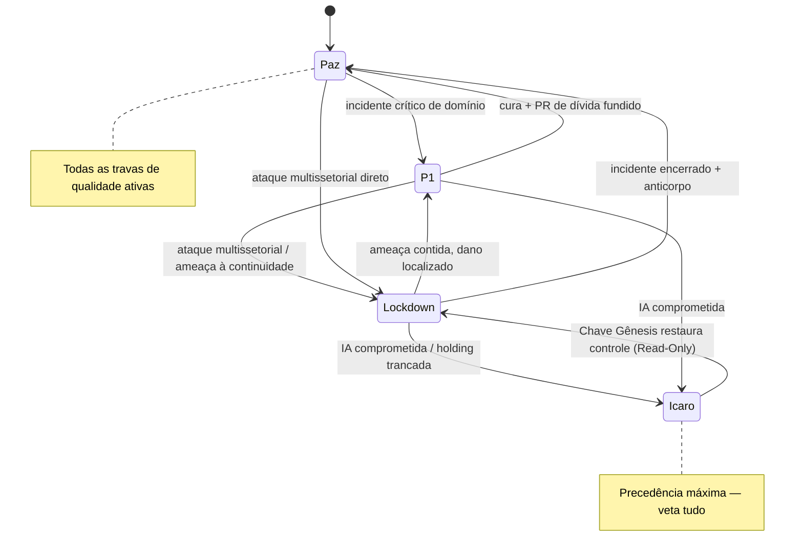

# 🚦 MÁQUINA DE ESTADOS OPERACIONAIS

> O sistema muda de comportamento conforme o nível de estresse. Antes, esses bypasses estavam espalhados ("Sabatina suspensa em P1", "HUD vira literal", etc.). Aqui eles viram **um contrato único e previsível**. A ordem de severidade segue a **Matriz de Precedência Absoluta**: `Ícaro > Lockdown > P1 > Paz`.

## Os 4 estados

### 🟢 PAZ (Steady-State)
Operação normal. **Todas as regras de qualidade ativas:**
- T.D.E. completo e obrigatório; Sabatina Inversa (Whetstone) ativa; Reserva de Domínio plena.
- Gamificação Invisível; HUD com verniz mítico (Modo Guilda conforme patente).
- Guardrails do DK-Ops, Escudo do Themis e travas do Árgus em rigor máximo.
- Andon Cord por Domínio disponível.

### 🟡 INCIDENTE P1 (Modo LOCK / HUD de Combate)
Disparado por incidente crítico de um domínio. **Prioriza velocidade de cura sobre cerimônia:**
- Ciclo vira **T.E.D.** (Execute primeiro, Documenta depois — com PR de dívida obrigatório na sprint seguinte).
- **Sabatina Inversa suspensa** (Bypass de Gravidade); Modo LOCK suspende a exigência de doc prévia só para o hotfix.
- **HUD → Silêncio Visual Absoluto:** interface vira literal/monocromática (mitologia desligada), ex.: "[CRÍTICO] Falha de auth porta 80, linha 42". *(Nome do módulo permanece o nome real — Themis é Themis; não há "tradução ISO", ver T-07.)*
- **Filtro de Morfeu** só interrompe o humano no que é acionável; auto-healing no resto.
- Andon Cord por Domínio disponível — **exceto** em serviço sob Quarentena de Override Fiduciário (ver `00_PROTOCOLO_OVERRIDE_E_RESGATE.md`).
- Punição é **Apoptose/Read-Only**, nunca rollback cego.

### 🟠 LOCKDOWN (Cisne Negro / Ataque Multissetorial)
Disparado por ataque coordenado (≥3 pilares violados em geografias diferentes) ou ameaça à continuidade.
- **Quórum de Contingência Horizontal** + **Follow-the-Sun** (bastão de soberania ativo); **Break-Glass** habilitado.
- Plantão humano vira **"Comandante de Teatro de Operações"** (comunicação assíncrona global + aval de risco de negócio).
- **Geocerca Jurisdicional** reforçada; EVELYN correlaciona IoT/Oráculo/ERP (gatilho preditivo, isola nó na borda).
- Expansão/deploys não essenciais congelados; foco em conter o blast radius.

### 🔴 ÍCARO (Queda da IA)
Estado máximo: a EVELYN está comprometida/indisponível ou deu falso-positivo trancando a holding.
- **Veta tudo** — o sistema vira **analógico** (humano assume).
- **Chave Gênesis** rebaixa a IA para **Read-Only** (não desliga; devolve controle para debug); Protocolo Gênesis (Quórum de Shamir 3/5, biometria vascular, PIN de Coação).
- **Gatilho de Cerco / Dead-Man's Drop:** se a Chave não for inserida em 12h durante Lockdown, deduz neutralização física da liderança → Safe Mode/Read-Only automático, congela dados, devolve visibilidade aos Hubs secundários.

## Diagrama de transições

## Tabela-resumo (o que liga/desliga)

| Regra | 🟢 Paz | 🟡 P1 | 🟠 Lockdown | 🔴 Ícaro |
|-------|--------|-------|-------------|----------|
| Ciclo | T.D.E. | T.E.D. | T.E.D. | Manual/analógico |
| Sabatina Inversa | ✅ | ⛔ (bypass) | ⛔ | ⛔ |
| HUD mítico | ✅ | ⛔ (literal) | ⛔ (literal) | ⛔ |
| Andon Cord | ✅ | ✅* | foco em conter | n/a |
| Break-Glass | sob Multisig | sob Multisig | ✅ habilitado | Chave Gênesis |
| EVELYN | plena | plena | preditiva | Read-Only/off |
| Deploys novos | ✅ | só hotfix | congelados | ⛔ |

\* exceto serviço sob Quarentena de Override Fiduciário.

> **Quem declara o estado:** P1 é automático (telemetria/SLA). Lockdown e Ícaro exigem confirmação humana (Quórum Horizontal) ou gatilho de segurança autônomo (Dead-Man's Switch), nunca um único indivíduo.
