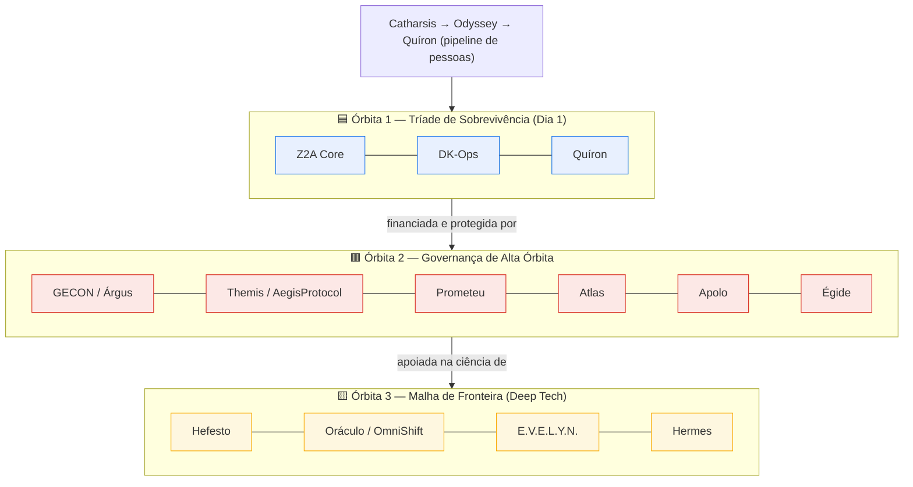

# 📚 ÍNDICE MESTRE — ZenithCode OS · Alinhamento (base V3.9, selado em V4.0)

> Resultado da leitura **completa** dos ~136 documentos do sistema. Para cada um dos 14 satélites foi gerado **1 documento canônico** consolidando base + adendos, com marcação de proveniência e supersessão (regra nova × desatualizada).

## ⚠️ Estatuto do acervo (leia antes de avaliar)
Honestidade epistêmica primeiro — para não prometer o que ainda não se provou:
- **Status de validação:** este acervo é um **produto bem pensado, ainda NÃO validado empiricamente.** Nenhum mecanismo passou por piloto com grupo de controle. O plano de validação está em `_REFORCOS_E_MELHORIAS/`.
- **Reforços R1–R6 = propostas em avaliação, não canon.** Onde um doc canônico é contestado por um reforço (ex.: UEBA/Pouso Forçado × R4), há um marcador ⚠️ apontando o "ponto sob revisão". **Regra (R6): nada sobe a canon sem evidência.**
- **Números são ilustrativos.** Salvo indicação de fonte, todo percentual/limiar (ex.: −15%, 40%, ~5s, 72h) é **hipótese de calibração**, não medição.
- **Falseabilidade:** apenas o **recorte de tese** (`_REFORCOS/TESE_RECORTE_DE_PESQUISA.md`) é hoje uma afirmação científica falseável. O restante é **camada de produto** (heurística de design), não ciência — ver a quarentena em `_REFORCOS/LEIS_E_HEURISTICAS.md`. Não confundir as duas gramáticas.

## 🚪 As Portas de Entrada (uma por público)
**Regra de vocabulário (inegociável):** o codinome mitológico vive **só na interface do desenvolvedor**. Em tese, paper, plano de negócios ou edital, use **apenas** os nomes técnicos (De-Para no Apêndice A da Entrada Técnica).

| Porta | Público | Uso | Status |
|-------|---------|-----|--------|
| **[`00_ENTRADA_TECNICA.md`](00_ENTRADA_TECNICA.md)** | qualquer externo | a visão completa e higienizada: 6 regras do núcleo, "a IA sugere / a regra decide", Teste do Apagão, plugins por gatilho, De-Para | ✅ pronta |
| **[`00_ENTRADA_ACADEMICA.md`](00_ENTRADA_ACADEMICA.md)** | orientador / banca | proposta de pesquisa de 1–2 páginas (problema → RQ → delta → método → critérios de morte → viabilidade). Anexo do e-mail ao PPGCC | ✅ pronta |
| **[`00_ENTRADA_COMERCIAL.md`](00_ENTRADA_COMERCIAL.md)** | investidor / cliente | one-pager de posicionamento (dor → mecanismo → prova → ROI) | 🟡 **esqueleto** — campos `[PILOTO: …]` só se preenchem com **número medido**. **Não enviar com placeholders.** |
| **Entrada Mitológica** (cultura/engajamento) | desenvolvedor interno | manual de cultura e pertencimento | ⏸️ **adiada — gatilho: contratação do 1º desenvolvedor.** O material já existe (o acervo canônico inteiro **é** a versão mitológica); falta público, não documento. Destilar quando houver time. |

## Como navegar (uso interno)
0. **`00_ENTRADA_TECNICA.md`** — a porta de entrada. O resto abaixo é o **detalhamento interno**; os módulos são **opcionais e sob demanda**, não um monolito obrigatório.
1. **`00_NUCLEO_Z2A_E_GECON.md`** — o Kernel que todos os satélites assumem (leia primeiro).
2. **`00_MAPA_DE_SUPERSESSAO.md`** — a pontuação "regra nova × obsoleta" (o coração do alinhamento).
3. **`00_GLOSSARIO.md`** — Pedra de Roseta (mítico → literal) de todo o vocabulário.
4. **`00_MATRIZ_INTEGRACAO.md`** — mapa "quem fala com quem" + diagrama de dependências.
5. **`00_TENSOES_ABERTAS.md`** — tensões seladas (V4.0) e as que ainda dependem da sua decisão.
6. **`00_PROTOCOLO_OVERRIDE_E_RESGATE.md`** — protocolo operacional V4.0/V4.1 (exceção comercial + resgate de squad + headcount + calibração).
7. **`00_ESTADOS_OPERACIONAIS.md`** — máquina de estados (Paz / P1 / Lockdown / Ícaro) e o que liga/desliga em cada um.
8. **`01_*` a `14_*`** — os 14 documentos canônicos por satélite.

### Laboratório (não-canônico)
- **`99_CRITICA_ADVERSARIAL.md`** — red team: 12 ataques às fundações + o golpe mais profundo.
- **`_REFORCOS_E_MELHORIAS/`** — os 6 planos de reforço (R1–R6) que respondem à crítica, cada um com experimento e critério de morte. Comece por `00_INDICE_REFORCOS.md`.

## Macroarquitetura — Kernel & Plugins (3 Órbitas)

> **Kernel & Plugins:** o **Núcleo (Z2A + GECON)** é o kernel inviolável; os 14 satélites são plugins acopláveis. Atualiza-se um satélite sem tocar o núcleo (Versionamento Seguro). Cada satélite é um **SITO** (ecossistema isolado por membrana de fronteira).

## Os 14 Satélites (+ núcleo)

| # | Satélite | Domínio | Manifestação física | Camada |
|---|----------|---------|---------------------|--------|
| 0 | **Z2A** (núcleo) | Constituição Arquitetural | — (OmniShift na borda) | Kernel |
| 1 | **Themis** | Segurança & Compliance | AegisProtocol | T2/T3 |
| 2 | **Árgus** | FinOps / Orçamento | GECON | Camada 0 |
| 3 | **DK-Ops** | Plataforma / SRE / IDP | (Go+Pulumi) | T1 |
| 4 | **Quíron** | RH Sociotécnico / Ergonomia | — | T1 |
| 5 | **Hefesto** | Hardware / IoT / Gêmeos Digitais | (Edge) | T3 |
| 6 | **E.V.E.L.Y.N.** | IA Central + Edge | (SLMs locais) | T1/T3 |
| 7 | **Apolo** | Go-To-Market / Vendas | API Gateway Comercial | T2 |
| 8 | **Prometeu** | Validação / Red Team Executivo | Conselho de Prometeu | T2 |
| 9 | **Atlas** | Governança Societária/Geográfica | — | T2 |
| 10 | **Catharsis** | Desconstrução de Mindset | Projeto Quimera | T1 |
| 11 | **Hermes** | Supply Chain / Logística | (via OmniShift) | nicho |
| 12 | **Odyssey** | Onboarding de Elite | Cockpits Setoriais | T1 |
| 13 | **Oráculo** | Data Mesh / LGPD | OmniShift | T3 |
| 14 | **Égide** | ITSM / Suporte | (Contrato de Payload) | T2 |

## Matriz Patologia (TCC) → Cura (Satélite)

O sistema é a solução de engenharia para o problema do TCC *"A Dissonância Estrutural..."*. Rastreabilidade:

| Patologia diagnosticada | Satélite(s) que cura |
|-------------------------|----------------------|
| Pedagogia da Superficialidade / Automação da Ignorância | Catharsis · Quíron · Odyssey · EVELYN |
| Inflação de Senioridade | Quíron (patente por evidência) · Prometeu · Odyssey |
| Code Bloat / Lei de Wirth / Green Software | Árgus · Sigma(Themis) · Z2A |
| Monocultura de Software / Zero-day global | Oráculo (Polinização Cruzada) · Themis/Sigma |
| Veneno Jurídico de IP (GPL viral) | Sigma(Themis) · Themis · Oráculo |
| Câmara de Eco Algorítmica (IA testa IA) | Prometeu · EVELYN (Shadow AI/Baseline) |
| Falência Técnica (Technical Bankruptcy) | DK-Ops (Apoptose/Lombada) · GECON/Árgus |
| Q-Day / quebra RSA-ECC | Themis/EVELYN (Criptografia Líquida/PQC) |
| Therac-25 / CrowdStrike / Log4j / Supply Chain | DK-Ops · Hefesto (Gêmeos) · Hermes/Sigma |
| Guilhotina Jurídica / bode expiatório (ART) | Themis · Atlas |
| Vendor Lock-in / Cloud Captive | Árgus · DK-Ops · Z2A (Hexagonal) |

## Resumo das Supersessões-Chave (ver `00_MAPA` para detalhe)

| Conceito | ❌ Obsoleto | ✅ Vigente V3.9 |
|----------|-------------|-----------------|
| Punição de falha em prod | Guilhotina Algorítmica / Rollback cego | **Apoptose de Código** (Imposto→Throttling→Read-Only) |
| Bloqueio SAST | Guilhotina do Themis | **Escudo do Themis** |
| Auditoria de incidente | Tribunal da Forja (p/ incidente) | **Filtro de Anticorpos** / Clínica de Resiliência |
| Moonshot | 10x imediato / Ônus Reputacional | **Vesting + Elevação de Doutrina** |
| Gamificação | Cassino Corporativo visível | **Gamificação Invisível** (Barra de Energia coletiva) |
| Andon Cord | Global | **Por Domínio** + Taxa de Solidariedade |
| Semântica/logs | Tradução de log na auditoria | **Triplo Plano de Dados** |
| Geografia | S.I.T.I.O./V.I.G.A./P.I.L.A.R./B.L.O.C.O./T.E.T.O. | **Hub Continental / Nodo / Célula Local** |
| Carreira | ELOS/ARCO tratados como níveis (drift) | **7 níveis da Constituição** (Nascer→Crescer→Guiar→Iluminar→Edificar→Transcender→Zenitar); ELOS/ARCO = guildas; +Orion (gestão) |
| Vocabulário | Jargão bélico (guilhotina/tribunal/letais) | **Paradigma Biológico** (apoptose/anticorpos/antifrágeis) |
| Precedência negócio × técnica | Veto técnico absoluto (parede de concreto) | **Override Fiduciário** (V4.0): gestão paga Assinatura Dupla + 40% Error Budget + perda do Andon |
| Gargalo de capacidade | Pedido de headcount por "achismo"/PowerPoint | **Expansão Cirúrgica** (V4.0): telemetria do Árgus/Quíron justifica a vaga; Resgate em 3 frentes antes |

## Decisão de carreira (selada pelo dono do sistema)
- ✅ A progressão é a **lista de 7 níveis da Constituição**: Nascer → Crescer → Guiar → Iluminar → Edificar → Transcender → Zenitar.
- ✅ **ELOS e ARCO são GUILDAS** (compartilhamento de conhecimento; ELOS = backend/SRE/Segurança, ARCO = UX/Front/QA), **não níveis**.
- ✅ **ORION** é a única adição: cargos de **encarregado/gestor/supervisor** (trilha de gestão paralela).
- ❌ Tratar ELOS/ARCO como degraus (Funil de Ascensão, Dupla Etiquetagem V3.6) foi um desvio descartado.

---

*Gerado a partir da leitura integral do acervo. Os PDFs originais não foram alterados. Estes documentos vivem em `_ALINHAMENTO_V3.9/`.*
