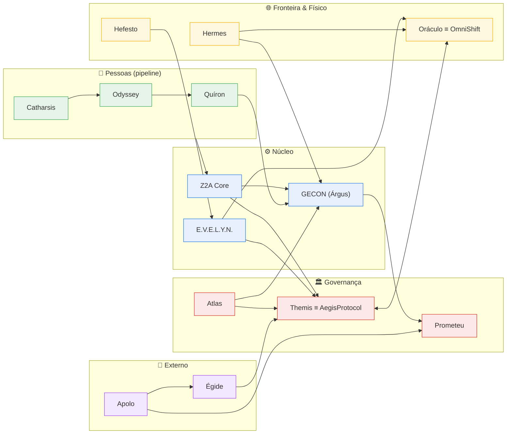

# 🔗 MATRIZ DE INTEGRAÇÃO — Quem fala com quem

> Cada satélite é um SITO autônomo (membrana de fronteira). A integração acontece **na fronteira** via Schema de Eventos (gRPC/Protobuf no OmniShift), nunca tocando a lógica interna do outro. Esta matriz consolida as integrações declaradas em cada documento.

## 1. Tabela de Dependências

Lê-se: **linha → coluna** ("a linha envia/depende de"). `●` = integração direta e forte; `○` = integração situacional.

| de ↓ / para → | Z2A | Themis | Árgus | DK-Ops | Quíron | Hefesto | EVELYN | Apolo | Prometeu | Atlas | Cathar. | Hermes | Odyssey | Oráculo | Égide |
|---------------|-----|--------|-------|--------|--------|---------|--------|-------|----------|-------|---------|--------|---------|---------|-------|
| **Z2A** | — | ● | ● | ● | ● | ○ | ● | ○ | ○ | ○ | ● | ○ | ○ | ● | ○ |
| **Themis** | ● | — | ○ | ● | ● | ● | ● | ○ | ● | ● | ○ | ● | ○ | ● | ● |
| **Árgus** | ● | ● | — | ● | ● | ○ | ● | ○ | ● | ● | | ● | ○ | ○ | ● |
| **DK-Ops** | ● | ● | ● | — | ○ | ○ | ● | ● | ○ | ○ | ● | ○ | ○ | ○ | ○ |
| **Quíron** | ● | ● | ● | ○ | — | | ● | ○ | ○ | ● | ● | | ● | ○ | ○ |
| **Hefesto** | ● | ● | ● | ○ | | — | ● | | | | | ● | ○ | ● | |
| **EVELYN** | ● | ● | ● | ● | ● | ● | — | ○ | ● | ○ | ● | ○ | ● | ● | ● |
| **Apolo** | ○ | ● | ● | ● | ○ | | ● | — | ● | ○ | | | ○ | ○ | ● |
| **Prometeu** | ○ | ● | ● | ○ | ○ | | ● | ● | — | ○ | | | | ○ | |
| **Atlas** | ○ | ● | ● | ○ | ● | | ○ | ○ | ○ | — | | ○ | | ● | |
| **Catharsis** | ● | ○ | | ● | ● | | ● | | | | — | | ● | ○ | ○ |
| **Hermes** | ○ | ● | ● | ○ | | ● | ○ | | | ○ | | — | | ○ | |
| **Odyssey** | ● | ○ | ○ | ○ | ● | ○ | ● | ○ | | | ● | | — | ○ | |
| **Oráculo** | ● | ● | ○ | ○ | ○ | ● | ● | ○ | ○ | ● | ○ | ○ | ○ | — | |
| **Égide** | ● | ● | ● | ○ | ○ | | ● | ● | | | ○ | | | | — |

## 2. Binômios e acoplamentos críticos

- **Themis ↔ Oráculo** — binômio de governança: Crypto-Shredding + cadeia de custódia (logs Append-Only com hashes).
- **Árgus ↔ Prometeu** — Cadeira da Avareza: o Árgus tem voz e veto orçamentário no Conselho.
- **Themis = AegisProtocol** e **Oráculo = OmniShift** — manifestações físicas (mesma entidade).
- **Hefesto → EVELYN Edge** — telemetria de borda alimenta a IA tática.
- **Catharsis → Odyssey → Quíron** — pipeline de pessoas (entrada → forja → operação).
- **Apolo → Égide** — o cliente entra pelo Apolo (vendas) e é sustentado pela Égide (suporte).
- **DK-Ops → Apolo** — logs viram munição comercial (ROI/cases).

## 3. Diagrama de Dependências (macro)

## 4. Regra de ouro da integração (SITOs)
Nenhum satélite chama a lógica interna de outro. Toda troca passa pela **fronteira** (Schema de Eventos versionado). Atualizar um satélite **não** quebra os demais (Kernel & Plugins / Versionamento Seguro).
