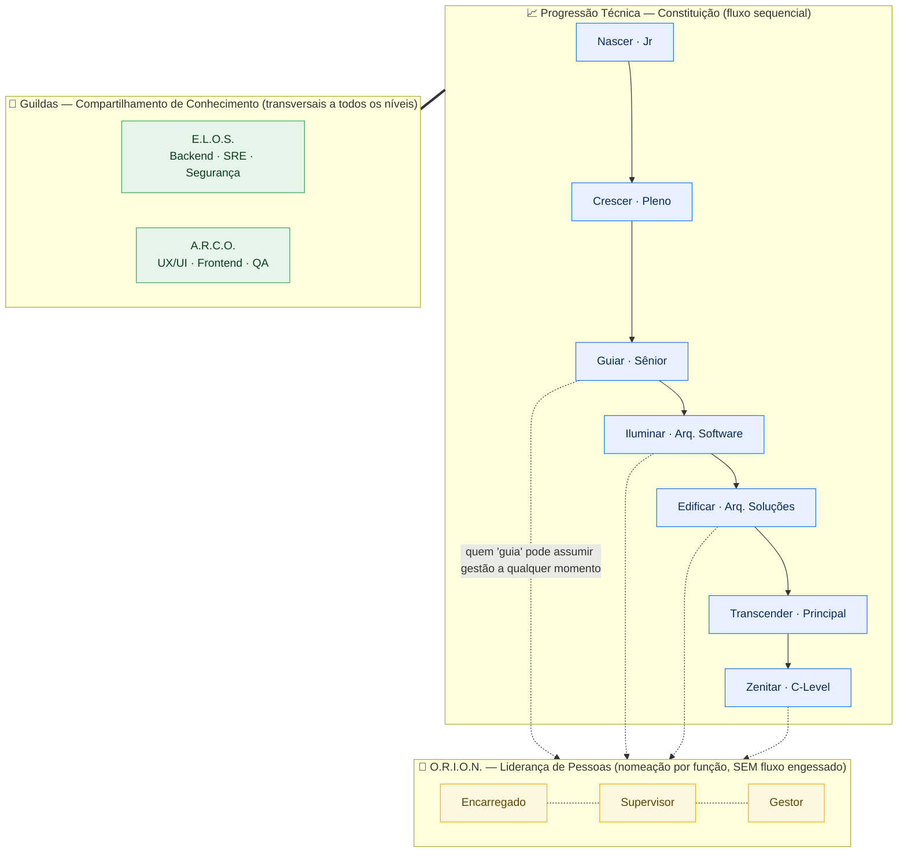

# 🩺 QUÍRON — Engenharia Sociotécnica & Dívida Humana

## 1. Identidade
Cuida da **"Dívida Humana"** — a saúde cognitiva e a trilha de carreira. Aplica a Lei de Conway + DDD à ergonomia. *"Nenhuma equipe escala sem o Quíron ativado."*

## 2. Razão de Existir (vínculo TCC)
Cura: *pedagogia da superficialidade / automação da ignorância* (forja a mente sem muletas), *inflação de senioridade* (patente baseada em evidência, não em escassez) e o *burnout* da "sociedade do cansaço" (Byung-Chul Han, citado no TCC).

## 3. Trilha de Carreira (CANÔNICA — conforme a Constituição; ver `00_MAPA §1.7`)
- **Progressão técnica (7 níveis da Constituição, V2.5 — VIGENTE):**
  `Nascer (Jr) → Crescer (Pleno) → Guiar (Sênior) → Iluminar (Arq. de Software) → Edificar (Arq. de Soluções) → Transcender (Principal) → Zenitar (C-Level)`.
- **O.R.I.O.N. = ÚNICA adição à Constituição:** trilha de **liderança de pessoas** — para quem "guia" o time, paralela à progressão técnica. Subdividível e **sem fluxo engessado**: é nomeação por função, não promoção linear obrigatória. Um técnico (de Guiar para cima, tipicamente) pode assumir um cargo ORION sem percorrer todos os degraus de gestão na ordem.

| Cargo ORION | Escopo de liderança | Autoridade típica |
|-------------|---------------------|-------------------|
| **Encarregado** | 1 squad / 1 Bounded Context | Distribui carga, conduz dailies, aciona Shadowing |
| **Supervisor** | Múltiplos squads de um domínio | Calibra Cc (carga cognitiva), media conflitos, valida CNFs de mentoria |
| **Gestor** | Domínio/Hub inteiro | Headcount, prioridade entre squads, interface com o T.E.T.O. |

- **Entrada no ORION:** por **CNFs de Mentoria + Estrutura** (não por Z-Points). A subdivisão é flexível — pode-se nomear direto a Supervisor/Gestor conforme a necessidade.
- **Limite de autoridade (precedência) — regra selada:** o ORION manda em **pessoas, prazos e processo**, e **por padrão não vence** uma decisão **arquitetural** (a Matriz de Precedência Absoluta é técnica: Ícaro → Andon Cord → Modo LOCK → Elegância Caótica).
- **Exceção comercial — Override Fiduciário (V4.0):** a gestão **pode** contornar o veto técnico para cumprir prazo de mercado, mas **paga o Preço da Exceção** (Assinatura Dupla no Themis Ômega + slash de 40% do Error Budget + perda do Andon Cord). A parede vira transação de risco — detalhe completo em **`00_PROTOCOLO_OVERRIDE_E_RESGATE.md`**. *Não é o ORION "vencendo" a técnica: é o negócio comprando a exceção e assumindo o passivo.*
- **E.L.O.S. e A.R.C.O. são GUILDAS (comunidades de compartilhamento de conhecimento), NÃO níveis de carreira:**
  - **E.L.O.S.** — engenharia pesada / backend / SRE / Segurança.
  - **A.R.C.O.** — UX/UI / Frontend / QA.
  - São transversais: profissionais de níveis diferentes (ex.: um Guiar e um Edificar) convivem na mesma guilda. Reúnem-se no rito **"A Forja"** (quinzenal) para revisar contratos/ADR e disseminar conhecimento.
- **Mapeamento de mercado (Apolo/B2B) — selado (T-01):** Nascer = cargos iniciais (Júnior / N1 / Trainee / Estágio) · Crescer = Pleno (Software Engineer / SE) · Guiar = Senior · Iluminar = Staff · Edificar = Principal · Transcender = Distinguished · Zenitar = Fellow / CTO (**praticamente exclusivo de cargos Officer / C-Level**).
- **Hierarquia de Pertencimento** (não de exclusão): mitiga a Síndrome do Impostor (~15% de produtividade preservada).
- **CNFs (Commits Não Fungíveis)** — lastro de ascensão, inegociável (não se compra com Z-Points). 3 fontes: Orgânica (mentoria), Sistêmica (refatoração/higiene), Forense (Post-Mortem injetado no Banco de Treino). A ascensão a **ORION** (gestão) exige CNFs de Mentoria+Estrutura; a **Zenitar** exige CNFs Forenses.
- **Anti-farming de CNF Forense (V4.1):** incidente autoinfligido não gera CNF (a EVELYN cruza autor do bug × autor do Post-Mortem); o valor é proporcional à dificuldade real (Baseline do Efesto), não ao volume; homologação final por **Zenitar**. Detalhe em `00_NUCLEO_Z2A_E_GECON.md`.

> ⚠️ **Correção de proveniência:** alguns documentos intermediários (Funil de Ascensão; "Dupla Etiquetagem" V3.6) trataram ELOS/ARCO como degraus de carreira. Isso foi um **desvio (drift)** — a Constituição prevalece: ELOS/ARCO são guildas, e a progressão é a lista de 7 níveis acima.

### 3.1 Diagrama da Carreira (técnica + ORION + guildas)

**Leitura do diagrama:**

- A **coluna azul** é a única escada com **ordem obrigatória** (a Constituição).
- A **caixa amarela (ORION)** é trilha de gestão: as ligações pontilhadas indicam que a entrada se dá **por nomeação/função**, não por sequência fixa — um técnico de Guiar para cima pode assumir um cargo ORION sem percorrer todos os degraus de gestão.
- As **guildas verdes** ligam-se a *toda* a progressão (linha dupla `===`): qualquer pessoa, em qualquer nível, pertence a uma guilda para compartilhar conhecimento (rito "A Forja").

## 4. Ergonomia Cognitiva (Telemetria de Dívida Humana)

> 🎯 **Papel narrativo (para textos externos):** a carga cognitiva **não é uma tese paralela** — é o **instrumento que mede o efeito colateral positivo** da governança determinística de IA (menos revisão manual de código alucinado → menos fadiga). Em documento de banca/investidor, apresente-a como **evidência secundária**, nunca como protagonista. Ver `00_ENTRADA_TECNICA.md`.
- **Fórmula vigente (V3.9):** `Cc = (Da · Cb) · (Tcx · Fr)`
  - `Da` = Densidade Arquitetural do Papel · `Cb` = Complexidade Base · `Tcx` = Taxa de Context Switching · `Fr` = Fator de Tolerância do Papel.
  - `Cc` > limite → **trava a injeção de novos escopos** no talento.
  - *Linhagem:* `Lc = Cd × S` (base V2.5) → `Cc = (Da·Cb)(Tcx·Fr)/Sp` (V2.8, com Sp = Fator de Segurança Psicológica) → fórmula atual.
  - **Operacionalização (V4.1) — de "fórmula" a modelo medível.** Cada variável ganha um **proxy de artefato** (mede o trabalho, não o corpo — coerente com R4):
    - `Da` (Densidade Arquitetural) → nº de Bounded Contexts/módulos sob titularidade (CODEOWNERS) + profundidade do grafo de dependências dominado.
    - `Cb` (Complexidade Base) → complexidade ciclomática média + acoplamento (métricas CK) do código sob responsabilidade (SonarQube/`ck`).
    - `Tcx` (Context Switching) → nº de contextos/repos distintos tocados por semana + interrupções de outro domínio (git/issue tracker).
    - `Fr` (Tolerância do Papel) → **não é medido; é um coeficiente de política por papel** (ex.: Arquiteto em DDD = alta sensibilidade a interrupção; Pleno em bugfix = baixa). Constante **declarada e calibrável**, não inferida.
    - **Limite** → **estimado empiricamente** (é justamente o objeto do modelo do Mestrado), não um número mágico.
  - ⚠️ **Honestidade epistêmica:** isto é um **modelo com proxies**, não uma lei física exata. Serve para **alertar tendência**, nunca para decisão automática punitiva. Validação formal = tese.
- **Fator de Fricção de Fronteira (Fgeo):** squad distribuído (Atlas) sofre decréscimo automático de capacidade (energia gasta com compliance LGPD+GDPR simultâneo).
- **Líder técnico** = interface de blindagem anti-context-switching.
- **Cc estendida à liderança (V4.1):** a fórmula passa a medir também a **carga cognitiva do gestor (ORION)** sob pressão — especialmente Override recorrente e resgates sucessivos. O exoesqueleto anti-burnout protege quem guia, não só o dev. Liderança estrangulada também trava a injeção de escopo (e dispara o Relatório de Viabilidade de Escala).

## 5. Cultura & Bem-Estar (vigente)
- **Cultura Blameless absoluta**; **UEBA** marca a fronteira (pune malícia, absorve erro honesto).
- **Pouso de Triunfo (Honorable Disconnect):** fadiga detectada → não bloqueio frio; mensagem validativa ("Missão Cumprida, código salvo") + micro-bônus "Taxa de Descanso Ativo".
  - **Pouso Forçado** (V3.1): degradação biológica severa por >2 janelas do Token de Sanidade → IDE salva e desabilita escrita por 6h. ⚠️ *Ponto sob revisão (R4, `_REFORCOS`): converter em **convite de salvamento**, nunca trava coercitiva de acesso — remover o acesso do engenheiro ao próprio trabalho gera passivo trabalhista de suspensão.*
- **Catarse Branca** (V3.1): semana trimestral de ócio criativo desmonetizado (taxímetro GECON suspenso); código nasce só em sandbox (sem merge sem Inquisição Semântica reativada — anti "Efeito Ressaca").
- **Forja Sintética / Fogo Sintético:** trimestralmente a EVELYN desliga sua auto-correção e gera um "Incidente P1 Falso"; a equipe debuga na unha (anti-atrofia); maestria = multiplicador de Z-Points.
- **Diário de Gratidão Algorítmica** (painel ORION): reconhecimento **explícito** de excelência (corrige o efeito da gamificação invisível).
- **Janela de Vidro / Friction Feed** (com Égide/Catharsis): o dev é blindado de tickets mas vê recortes assíncronos do usuário falhando (empatia, anti-torre-de-marfim).

## 6. Ritos & M&A
- **Tribunal da Forja** — ✅ vigente **apenas para avaliação de carreira/promoção** (avalia resiliência adaptativa via ADR, não decoreba). ⚠️ **Não** usar para incidentes (isso é Filtro de Anticorpos/Clínica de Resiliência).
- **Protocolo Rosetta** (M&A, sob Quíron): tradução cultural suave/invisível na IDE do talento adquirido. *"OmniShift assimila dados; Quíron assimila mentes."*
- **Shadowing guiado:** pareia o novato com o GUIAR de **menor** carga cognitiva (Cc) da semana (distribui o peso).

## 7. Topologia de Times (Centauro)
- **Squad Centauro:** 3-4 Engenheiros de Elite + 1 instância dedicada da EVELYN ("5º membro"). Perfil = **Decomposição Lógica** (humano desenha DDD; IA escreve as "paredes"). Métrica: IDC (ver Árgus).
- Times de Missão (vigentes desde V2.5): L.U.A., C.O.F.R.E., F.O.G.O., E.S.C.U.D.O., A.R.I.E.T.E., F.Ê.N.I.X.

## 8. Supersessões (pontuação)
- ⚠️→✅ **Trilha de carreira:** reconciliada (espinha Dupla Etiquetagem + ORION transversal). Nomes V2.5 ❌ obsoletos.
- ⬆️ **Fórmula de carga cognitiva:** evoluiu 3 vezes; usar a V3.9.
- ⬆️ **Tribunal da Forja:** escopo **reduzido** a carreira; incidentes migraram p/ Filtro de Anticorpos.

## 9. Integrações
Recebe talentos do **Catharsis/Odyssey**; reporta Dívida Humana ao **Árgus**; UEBA com **Themis**; Fgeo com **Atlas**; Forja Sintética com **EVELYN**.

A Carga Cognitiva (Cc) é também o **sensor de colapso** que dispara o Gatilho de Expansão Cirúrgica e o Protocolo de Resgate de Esquadrão (V4.0) — e o Quíron emite os **CNFs Forenses** do Mercado de Mercenários de Elite. Ver **`00_PROTOCOLO_OVERRIDE_E_RESGATE.md`**.
