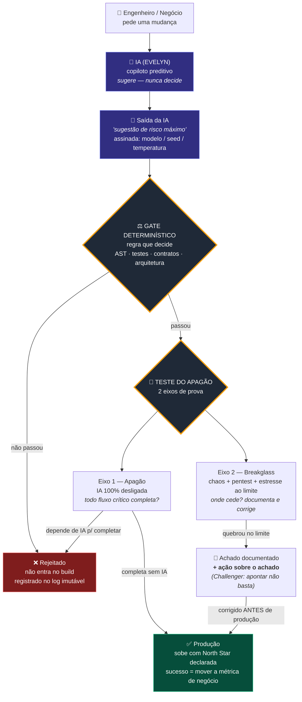
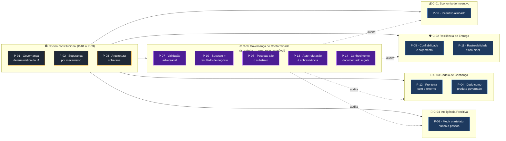
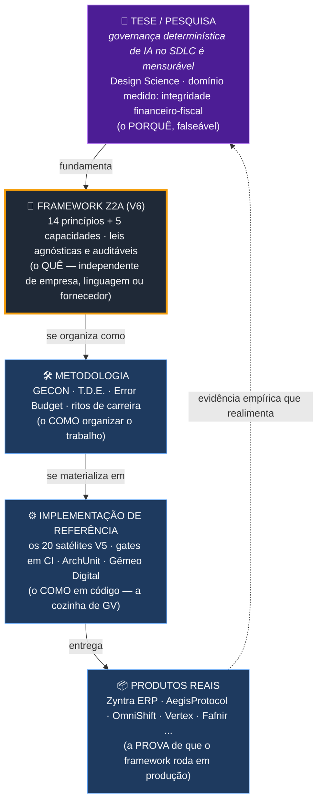

# 🎨 Z2A em diagramas

> **Como usar.** Três diagramas, do mais simples ao mais estrutural. O primeiro conta a tese inteira em um fluxo; o segundo mostra como os 14 princípios se agrupam em 5 capacidades; o terceiro separa as 5 camadas que as pessoas costumam confundir. Os blocos abaixo são [Mermaid](https://mermaid.js.org/) — renderizam direto no GitHub, no VS Code com a extensão Mermaid, ou colados em [mermaid.live](https://mermaid.live). *Os codinomes (EVELYN, Teste do Apagão) são Cultura; as frases normativas são Lei; os mecanismos citados são Sugestão.*

---

## 1 · A tese em um fluxo — "a IA sugere; a regra decide"

É o coração do Z2A. A IA entra como copiloto que **sugere**; uma **regra determinística** decide o que entra no build; e nada sobe sem passar pelo **Teste do Apagão** (prova que o sistema opera sem IA e sobrevive à ruptura).

> **Leitura em uma frase:** a IA é o turbo, não o combustível — se ela some, o carro ainda anda; e antes de vender o carro, leva-se ao limite para achar onde quebra.

---

## 2 · Os 14 princípios agrupados nas 5 capacidades

Os **14 princípios** são a constituição auditável (a Lei). As **5 capacidades** são feixes de prática reutilizável — cada uma realiza vários princípios ao mesmo tempo. A **C-05 (Governança de Conformidade)** é a espinha: é ela que torna todos os princípios acionáveis ("isto fere P-04, revisar").

> **Leitura em uma frase:** P-01 a P-03 são a constituição que todo o resto assume; as capacidades empacotam a prática; a C-05 é o que faz os princípios morderem.

---

## 3 · As 5 camadas — o que é framework, o que não é

A confusão mais comum sobre o Z2A é misturar cinco coisas diferentes. Este diagrama as separa: o **framework** (leis agnósticas) fica no topo; a **tese** o sustenta por baixo; e **metodologia, implementação e produto** são como o framework vira realidade na firma de GV. O framework não depende dos produtos para existir — os produtos são a prova de que ele roda.

> **Leitura em uma frase:** o framework é o conjunto de leis; a tese prova que elas funcionam; os produtos são a prova viva — mas a lei vale mesmo para quem nunca viu os produtos de GV.

---

## Qual diagrama levar para cada conversa

| Público | Comece por | Por quê |
| --- | --- | --- |
| **Comercial** (investidor, cliente) | Diagrama 1 | Mostra o valor em 10 segundos: "se a IA cai, seu faturamento não cai." |
| **Acadêmico** (banca, orientador) | Diagrama 3 → depois 2 | Separa tese de framework (rigor) e mostra a estrutura auditável. |
| **Técnico** (engenheiro, arquiteto) | Diagrama 2 → depois 1 | Vê a constituição e como o gate determinístico opera no fluxo. |

---

*Vitrine. Para o detalhe por público, ver `01_COMERCIAL.md`, `02_ACADEMICO.md`, `03_TECNICO.md`. Para a Lei completa, ver `../01_PRINCIPIOS.md` e `../02_CAPACIDADES_TRANSVERSAIS.md`. Conteúdo reformulado para conformidade de licença.*
