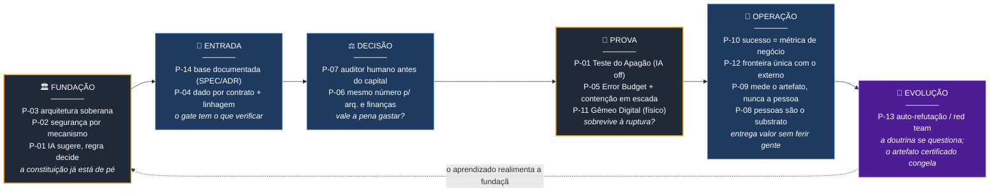
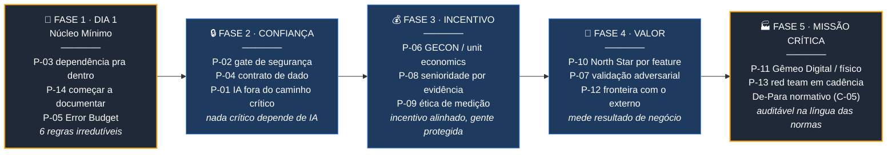
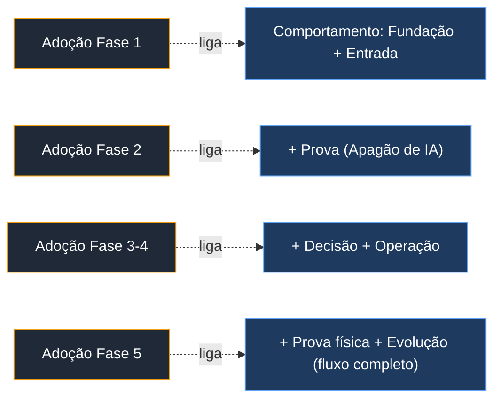

# 🗺️ Roadmap dos 14 princípios

> **Por que dois roadmaps.** Os 14 princípios podem ser lidos por dois eixos de tempo diferentes, e os dois juntos contam a história inteira:
>
> - **Roadmap A — Comportamento:** a ordem em que os princípios **atuam** quando uma mudança atravessa o sistema (do pedido à evolução). É o *runtime* do framework — o que acontece a cada mudança, todo dia.
> - **Roadmap B — Adoção:** a ordem em que um time **implanta** os princípios ao adotar o Z2A (do Dia 1 à missão crítica). É o *rollout* — acontece uma vez, por maturidade.
>
> A ligação entre eles: **o comportamento maduro (A) só existe depois que a adoção (B) completou.** Um time no Dia 1 roda só o começo do fluxo A; um time maduro roda o fluxo inteiro. Os blocos abaixo são [Mermaid](https://mermaid.js.org/) — renderizam no GitHub, no VS Code com a extensão Mermaid, ou em [mermaid.live](https://mermaid.live). *Frases normativas são Lei; mecanismos citados são Sugestão; codinomes são Cultura.*

---

## Roadmap A · Comportamento — uma mudança atravessando o sistema

Leia da esquerda para a direita: é o caminho de **uma** mudança, do momento em que alguém a pede até a evolução do próprio framework. Cada estação mostra quais princípios estão no comando naquela etapa. A seta de retorno fecha o ciclo — o aprendizado da evolução realimenta a fundação.

> **Leitura em uma frase:** fundação de pé → dado e base documentada entram → decisão humana libera capital → o Teste do Apagão prova a ruptura → opera entregando valor sem ferir gente → o framework se refuta e aprende.

---

## Roadmap B · Adoção — um time implantando o Z2A

Leia da esquerda para a direita: é a **maturidade** de um time ao longo do tempo. Ninguém liga os 14 princípios no primeiro dia. Começa-se pelo Núcleo Mínimo (6 regras irredutíveis) e sobe-se até a capacidade de operar em missão crítica, auditável na língua das normas (DO-178C / IEC 61508).

> **Leitura em uma frase:** começa pelas 6 regras do Dia 1 → fecha a confiança (segurança, dado, IA contida) → alinha incentivo e protege as pessoas → passa a medir valor de negócio → chega a missão crítica, auditável por norma.

---

## Como A e B se encaixam

| | Roadmap A — Comportamento | Roadmap B — Adoção |
| --- | --- | --- |
| **Eixo de tempo** | Uma mudança (segundos a dias) | Uma organização (meses a anos) |
| **Acontece** | A cada mudança, sempre | Uma vez, por maturidade |
| **Pergunta que responde** | "O que o framework faz com esta mudança?" | "Por onde eu começo a adotar?" |
| **Fim da linha** | A doutrina se refuta e aprende (P-13) | Missão crítica auditável (P-11, P-13, C-05) |

**A ponte entre os dois:** cada fase de adoção em **B** *liga* um trecho do comportamento em **A**. Um time na Fase 1 só roda "Fundação + Entrada" do fluxo A. Um time na Fase 5 roda o fluxo A inteiro, incluindo a prova do Apagão no físico e a auto-refutação. Ou seja: **B é a ordem em que você acende as estações de A.**

---

## Qual roadmap levar para cada conversa

| Público | Mostre | Por quê |
| --- | --- | --- |
| **Comercial** | Roadmap B | "Você não precisa comprar tudo de uma vez — adota por fases, valor desde o Dia 1." |
| **Acadêmico** | Roadmap A | Mostra o framework como sistema de comportamento falseável (fecha em P-13, auto-refutação). |
| **Técnico** | A e B juntos + a ponte | Vê o runtime e o rollout, e entende que adotar = acender estações do comportamento. |

---

*Vitrine. Complementa `04_DIAGRAMA.md` (tese, capacidades, camadas). Para a Lei completa dos 14 princípios, ver `../01_PRINCIPIOS.md`; para as 5 capacidades, `../02_CAPACIDADES_TRANSVERSAIS.md`. Conteúdo reformulado para conformidade de licença.*
